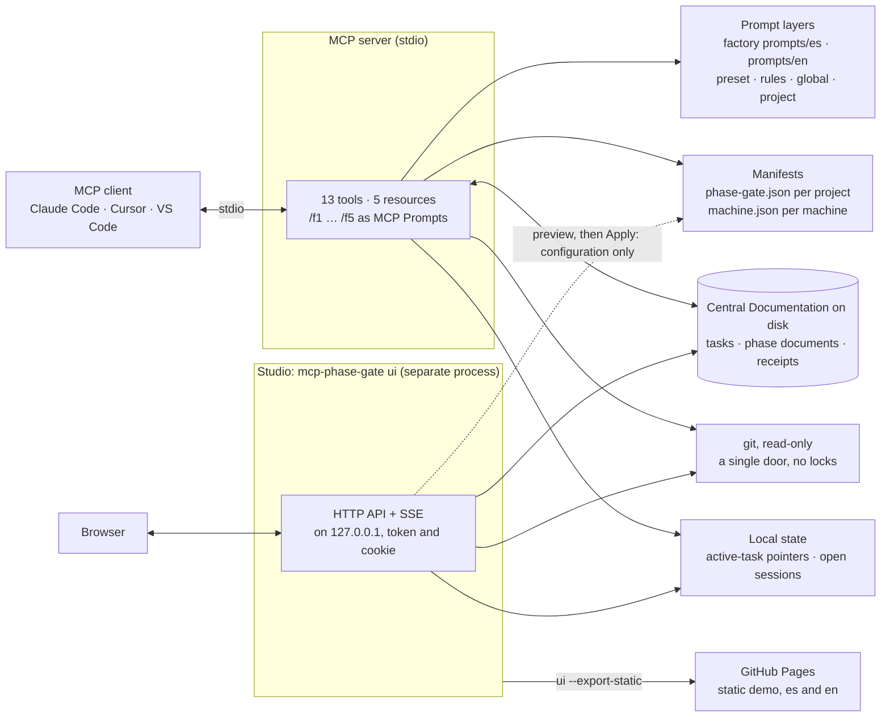
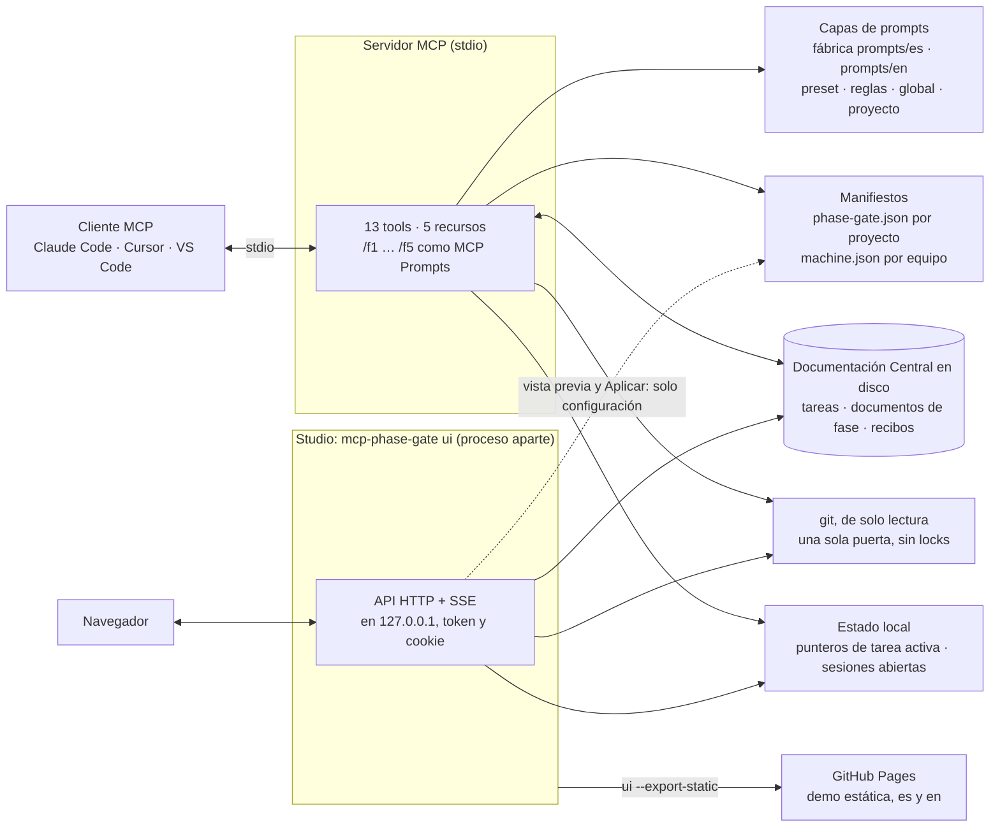

# Contributing

Thanks for looking at the code. This page says how the repository is laid out, how to build and test it, and what to check before you open a pull request. *En español: [Español](#español).*

## Architecture



- **The server** talks to the client over stdio and keeps almost no state of its own (one active-task pointer per project): the phase of a task is deduced from which documents exist on disk, the prompt is assembled from its layers on every call, and git is queried through one read-only door that takes no locks and runs nothing a repo brings along.
- **The Central Documentation** is a plain folder you own (synced or not). The server only writes inside task folders, and phase 4's receipts only through `record_batch`.
- **The Studio** is a separate process, loaded only by `ui`: a local HTTP API with live events (SSE) over the same functions the tools use. It never writes task documents or receipts. `--export-static` turns it into the read-only site published on GitHub Pages.

Every design choice is recorded with its reason and the alternative it discarded in [`docs/decisiones.md`](docs/decisiones.md), the **architecture decision record**, newest first (in Spanish).

## Development (if you change the code)

> **Note:** this applies to **code** changes only. If all you edited was a prompt under `prompts/<language>/*.md` or a preset, there is **nothing to build and nothing to restart** — they're read on every call.

The source lives in `src/`, split by responsibility:

| File | What it handles |
|------|-----------------|
| `config.ts` | Environment variables and their aliases, reading `.env` and the paths and language of `machine.json`, where state and configuration live, server identity |
| `paths.ts` | How every path is built, and the check that it stays inside its base |
| `phases.ts` | Discovering the phases and reading their files |
| `capas.ts` | The layers, a project's effective configuration (language, preset and rules) and the assembly of each prompt |
| `bloques.ts` | Reading blocks and applying them to slots |
| `vocabulario.ts` | The only place with the texts the code looks for or writes in a fixed form (headings, receipt keys, document names, markers, slot aliases), in Spanish and English |
| `i18n/` | The server's messages in both languages: one catalog per group of modules in `i18n/textos/`, joined by `mensajes.ts` |
| `manifiesto.ts` | `phase-gate.json`, a project's language, the available presets and the published JSON Schemas |
| `maquina.ts` | The shape of `machine.json`, so that the server, `doctor` and Settings agree on what "broken" means |
| `ajustes/` | What Settings writes: the plans for a machine's and a project's configuration, with their preview, before the Studio applies them |
| `roots.ts` | The project worked out from the client's open folders |
| `git.ts` | The single door to git, read-only for the server (its one write is the Studio demo's, in its own temporary repos) |
| `repos.ts` | Reading files and git state from a project's repos |
| `recibos.ts` | Batch receipts as data: reading them, writing them and their file name |
| `anclas.ts` | Batch anchors: the commit on the branch, an artifact's sha256, and re-checking them |
| `lotes.ts` | `record_batch` and `get_batch_status`: recording each batch, the phase 4 document and the commits for phase 5 |
| `tasks.ts` | Which tasks exist, which phase each is on, which one is active, the gate and inherited pending items |
| `schemas.ts` | Each tool's arguments, with their description and error message |
| `servidor.ts` | The server's tools. It computes nothing: it translates between the protocol and the above |
| `recursos.ts` | The `phase-gate://` resources |
| `prompts-mcp.ts` | The `/f1`…`/fN` commands as MCP Prompts |
| `confirmacion.ts` | Direct confirmations to the user (elicitation) |
| `diagnostico.ts` | The X-ray shared by `doctor`, `get_orchestrator_status` and `phase-gate://estado` |
| `cli.ts` | The command line: `doctor`, `init`, `eject`, `ui`, `--help`, `--version` |
| `init.ts` | `init`: registering the server in the clients, copying the commands and migrating |
| `eject.ts` | `eject`: copying a prompt, a slot, a command or a preset into a layer of your own |
| `log.ts` | Logging: stderr and, with a client connected, MCP notifications |
| `sesiones.ts` | The record of open MCP sessions and their project, which the Studio reads |
| `studio/` | The Studio's backend, loaded only by `ui`: the local HTTP server and its security, the read API, live events, writes with preview and fingerprint, the demo and the static export |
| `index.ts` | The entry point: the command line, or the server over stdio |

The client runs the compiled `build/index.js`, so after any change:

```bash
npm run build
```

Then restart the MCP server in your client so it picks up the new version.

Available scripts:
- `npm run build` → compiles TypeScript into `build/`, copies the demo's texts, and builds the Studio's frontend (`studio/`, Vite and Preact) into `studio/dist/`, checking its size budget.
- `npm test` → compiles the tests and runs them with Node's test runner (needs **Node 22+**).
- `npm start` → runs the compiled server.
- `npm run dev` → recompiles into `build/` on every change (`tsc --watch`).
- `npm run test:e2e` → the Studio's end-to-end tests in a headless Chromium (Playwright), after `npm run build`. The browser goes inside `node_modules`: `PLAYWRIGHT_BROWSERS_PATH=0 npx playwright install chromium`.

Tests live in `test/` and need no extra dependency: they use `node:test`, which ships with
Node. The Studio's end-to-end tests live in `studio/e2e/`. They build a throwaway central-documentation tree in a temp folder, so they never touch
yours. CI runs them on every PR.

Two scripts are worth knowing. `node scripts/indice-decisiones.mjs` regenerates the index at the top of `docs/decisiones.md` (a test fails if it is out of date). `node scripts/comparar-comentarios.mjs <before> <after>` takes two commits and proves that only comments changed between them, by comparing the compiled output, the Studio's build and the parsed YAML and JSON.

The site's media (the GIF, video and poster of the READMEs, the three screenshots of the landing page, and the 1200 × 630 image of the link preview, `social-preview-en.png` and `social-preview-es.png`) are not in git: `scripts/capturas-studio.mjs` and `scripts/medios.mjs` generate them from the real demo in the GitHub Pages workflow on every version tag, in both languages, and they are published at `https://montse2308.github.io/mcp-phase-gate/medios/`.

### Where everything is

| What you're looking for | Where |
|-------------------------|-------|
| What the project does today | The two READMEs ([`README.md`](README.md) and its Spanish twin, [`README.es.md`](README.es.md)) and the guides in [`docs/guide/`](docs/guide) and [`docs/guia/`](docs/guia) — **change one, change its twin** |
| Why it's designed this way | [`docs/decisiones.md`](docs/decisiones.md), the architecture decision record (Spanish) |
| How it was built, and what was measured | [`docs/case-study.md`](docs/case-study.md) (in Spanish: [`docs/caso-de-estudio.md`](docs/caso-de-estudio.md)) |
| The fixed terms in both languages | [`docs/glosario.md`](docs/glosario.md) |
| The `/f1`–`/f5` commands | Their text in [`prompts/en/commands/`](prompts/en/commands) and [`prompts/es/comandos/`](prompts/es/comandos); how they reach each client in [`docs/phase-commands.md`](docs/phase-commands.md) |
| The presets and the schemas | [`presets/en/`](presets/en), [`presets/es/`](presets/es) and [`schema/`](schema). The schemas are generated from the zod shapes: `npm run build && node scripts/generar-esquemas.mjs` |
| What changed in each version | The [Releases](https://github.com/Montse2308/mcp-phase-gate/releases) on GitHub; their drafts are in [`docs/notas/`](docs/notas) |
| The version 3 plan | [`docs/plan-maestro-v3.md`](docs/plan-maestro-v3.md) (Spanish) |
| That a change broke nothing | [`test/`](test), via `npm test`. CI runs them on every PR |
| A security problem | [`SECURITY.md`](SECURITY.md): report it privately, not in an issue |
| What's still missing | [Issues](https://github.com/Montse2308/mcp-phase-gate/issues) — grouped under the `v1-uso-propio` and `v2-publico` labels |
| What's already been done | The commit history and merged PRs |


## Before you open a pull request

- `npm run build` and `npm test` pass. If you touched the Studio, the scripts or the end-to-end tests, `npm run test:e2e` passes too. CI runs the tests on Linux, Windows and macOS, and once more against git 2.43.
- A change that someone sees (what the project does, how to install it, a setting) goes in both READMEs and in both guides, in English and in Spanish.
- A design decision goes in [`docs/decisiones.md`](docs/decisiones.md): what was decided, why, and what was discarded. If it reverses an earlier one, you add a new entry and mark the old one; nothing is deleted.
- Commits and comments follow the [conventions](#conventions) below.
- By taking part you agree to follow the [Code of Conduct](CODE_OF_CONDUCT.md).

## Conventions

- **Comments in `src/`** are written in English, and only the ones that matter: why something isn't obvious, a security reason, a trap of a system (Windows, BOM, `mtime`…) and a contract between modules. What the code already says doesn't need a comment. When the why is long, it goes to [`docs/decisiones.md`](docs/decisiones.md) and the comment links to it.
- **Everything else** (the Studio in `studio/src/`, the tests, `studio/e2e/`, the scripts, `.github/` and the configuration) is commented in Spanish. **The names of the tests** are in Spanish too.
- **The product's texts** (the interface and the server's messages) are in both languages, always through their catalogs, with the fixed terms of [`docs/glosario.md`](docs/glosario.md).
- **A comment never points to someone's notes** (a plan, a stage, a finding): it says why on its own.
- **Commits** are small, each one compiles, and they follow the repository's style: `type(scope): what changes`, in Spanish (see `git log`).

## Publishing a version

A version is published by a tag, never by a merge. The order is what keeps a tag from landing on a commit that doesn't carry its version:

1. The pull request that ships the version also raises `version` in `package.json` and `package-lock.json`. Its CI is green before it merges.
2. After the merge, `git fetch origin master` and check that `git tag -l` shows no stray local tag and that `git show origin/master:package.json` has the new version.
3. Tag the merge commit with an annotated tag, `git tag -a vX.Y.Z <commit>`, and push it **by name**, `git push origin vX.Y.Z`. Never `git push --tags`.
4. Two workflows start from the tag:
   - `publish.yml` checks that the tag and `package.json` agree and publishes to npm with provenance, with no stored token: npm trusts this repository and this exact file, so don't rename or move it. A version with a hyphen (`4.1.0-rc.1`) goes out with the `beta` tag and never becomes `latest`. It installs npm 11 on purpose, because the version Node 22 brings can't authenticate by OIDC.
   - `pages.yml` publishes the landing page, the demo and the media, and only for tags without a hyphen. Run by hand on a branch it builds the site and leaves it as the `sitio-completo` artifact for 14 days, without deploying.
5. The version's Release on GitHub carries its notes: `gh release create <tag> --verify-tag --notes-file docs/notas/<tag>.md`. `--verify-tag` matters: without it, `gh` would create a missing tag, and that would publish.

**A fix that only touches the site** (the landing page, the demo, the media) also ships with a new version, because Pages only publishes on tags.

### A 4.0.x fix

A fix to a released version goes out as a patch, from `master`:

1. A branch from `origin/master` (`fix/<what>`), with the fix and its test.
2. In the same pull request, `version` goes up by one patch (`4.0.0` → `4.0.1`) in `package.json` and `package-lock.json` (`npm version patch --no-git-tag-version` does both), and the notes go in `docs/notas/v4.0.1.md`, in both languages.
3. The pull request goes to `master` with its CI green, and from there it is the same as any version: steps 2 to 5 above.

A security fix follows the same path, but it is prepared in the private advisory of its report (see [`SECURITY.md`](SECURITY.md)), and the advisory is made public only once the version is on npm.

---

# Español

Gracias por mirar el código. Esta página dice cómo está organizado el repositorio, cómo compilarlo y probarlo, y qué revisar antes de abrir un pull request. *In English: [Contributing](#contributing).*

## Arquitectura



- **El servidor** habla con el cliente por stdio y casi no guarda estado propio (un puntero de tarea activa por proyecto): la fase de una tarea se deduce de qué documentos hay en disco, el prompt se arma con sus capas en cada llamada, y a git se le pregunta por una sola puerta de solo lectura que no toma locks ni ejecuta nada que traiga el repo.
- **La Documentación Central** es una carpeta tuya, sincronizada o no. El servidor solo escribe dentro de las carpetas de tarea, y los recibos de la Fase 4 solo con `record_batch`.
- **El Studio** es un proceso aparte, que solo carga `ui`: una API HTTP local con eventos en vivo (SSE) sobre las mismas funciones que usan las tools. Nunca escribe documentos de tareas ni recibos. `--export-static` lo convierte en el sitio de solo lectura que se publica en GitHub Pages.

Cada decisión de diseño está registrada, con su porqué y la alternativa que descartó, en [`docs/decisiones.md`](docs/decisiones.md), el **registro de decisiones de arquitectura**, la más reciente arriba.

## Desarrollo (si modificas el código)

> **Ojo:** esto aplica solo a cambios en el **código**. Si lo único que tocaste fue
> un prompt de `prompts/<idioma>/*.md` o un preset, **no hace falta compilar ni reiniciar nada** — se leen
> en cada llamada.

El código fuente está en `src/`, repartido por responsabilidad:

| Archivo | De qué se encarga |
|---------|-------------------|
| `config.ts` | Variables del entorno y su alias, lectura del `.env` y de las rutas y el idioma de `machine.json`, dónde viven el estado y la configuración, identidad del servidor |
| `paths.ts` | Cómo se arma cada ruta y la comprobación de que no se salga de su base |
| `phases.ts` | Descubrir las fases y leer sus archivos |
| `capas.ts` | Las capas, la configuración efectiva de un proyecto (idioma, preset y reglas) y el ensamblado de cada prompt |
| `bloques.ts` | Leer los bloques y aplicarlos sobre las ranuras |
| `vocabulario.ts` | El único lugar con los textos que el código busca o escribe con una forma fija (encabezados, claves de los recibos, nombres de documento, marcadores, alias de ranura), en español y en inglés |
| `i18n/` | Los mensajes del servidor en los dos idiomas: un catálogo por grupo de módulos en `i18n/textos/`, que junta `mensajes.ts` |
| `manifiesto.ts` | `phase-gate.json`, el idioma de un proyecto, los presets disponibles y los JSON Schema publicados |
| `maquina.ts` | El shape de `machine.json`, para que el servidor, `doctor` y Ajustes entiendan lo mismo por «roto» |
| `ajustes/` | Lo que escribe Ajustes: los planes de la configuración de un equipo y de un proyecto, con su vista previa, antes de que el Studio los aplique |
| `roots.ts` | El proyecto deducido de las carpetas abiertas en el cliente |
| `git.ts` | La única puerta a git, de solo lectura para el servidor (su única escritura es la de la demo del Studio, en sus propios repos temporales) |
| `repos.ts` | Leer archivos y estado de git de los repos de un proyecto |
| `recibos.ts` | Los recibos de lote como datos: leerlos, escribirlos y su nombre de archivo |
| `anclas.ts` | Las anclas de los lotes: el commit en la rama, el sha256 de un artefacto, y reverificarlas |
| `lotes.ts` | `record_batch` y `get_batch_status`: registrar cada lote, el documento de la Fase 4 y los commits para la Fase 5 |
| `tasks.ts` | Qué tareas existen, en qué fase va cada una, cuál está activa, la compuerta y los pendientes heredados |
| `schemas.ts` | Los argumentos de cada tool, con su descripción y su mensaje de error |
| `servidor.ts` | Las tools del servidor. No calcula nada: traduce entre el protocolo y lo anterior |
| `recursos.ts` | Los recursos `phase-gate://` |
| `prompts-mcp.ts` | Los comandos `/f1`…`/fN` como MCP Prompts |
| `confirmacion.ts` | Las confirmaciones directas al usuario (elicitation) |
| `diagnostico.ts` | La radiografía que comparten `doctor`, `get_orchestrator_status` y `phase-gate://estado` |
| `cli.ts` | La línea de comandos: `doctor`, `init`, `eject`, `ui`, `--help`, `--version` |
| `init.ts` | `init`: registrar el servidor en los clientes, copiar los comandos y migrar |
| `eject.ts` | `eject`: copiar un prompt, una ranura, un comando o un preset a una capa propia |
| `log.ts` | El log: stderr y, con un cliente conectado, notificaciones MCP |
| `sesiones.ts` | El registro de las sesiones MCP abiertas y su proyecto, que lee el Studio |
| `studio/` | El backend del Studio, que solo carga `ui`: el servidor HTTP local y su seguridad, la API de lectura, los eventos en vivo, las escrituras con vista previa y huella, la demo y el export estático |
| `index.ts` | El punto de entrada: la línea de comandos, o el servidor por stdio |

El cliente ejecuta la versión compilada `build/index.js`, así que después de cualquier cambio:

```bash
npm run build
```

Y luego reinicia el MCP en tu cliente para que cargue la nueva versión.

Scripts disponibles:
- `npm run build` → compila TypeScript a `build/`, copia los textos de la demo y compila el frontend del Studio (`studio/`, Vite y Preact) a `studio/dist/`, comprobando su presupuesto de tamaño.
- `npm test` → compila los tests y los corre con el runner de Node (necesita **Node 22 o superior**).
- `npm start` → ejecuta el servidor compilado.
- `npm run dev` → recompila a `build/` con cada cambio (`tsc --watch`).
- `npm run test:e2e` → las pruebas de extremo a extremo del Studio en un Chromium sin ventana (Playwright), después de `npm run build`. El navegador va dentro de `node_modules`: `PLAYWRIGHT_BROWSERS_PATH=0 npx playwright install chromium`.

Los tests viven en `test/` y no necesitan ninguna dependencia extra: usan `node:test`, que
viene con Node. Las pruebas de extremo a extremo del Studio viven en `studio/e2e/`. Montan una Documentación Central de mentira en una carpeta temporal, así que
no tocan la tuya. El CI los corre en cada PR.

Hay dos scripts que conviene conocer. `node scripts/indice-decisiones.mjs` regenera el índice de arriba de `docs/decisiones.md` (un test falla si está desactualizado). `node scripts/comparar-comentarios.mjs <antes> <después>` toma dos commits y prueba que entre ellos solo cambiaron comentarios, comparando el compilado, el build del Studio y los YAML y JSON ya interpretados.

Los medios del sitio (el GIF, el video y el póster de los README, las tres capturas de la portada y la imagen de 1200 × 630 de la vista previa del link, `social-preview-en.png` y `social-preview-es.png`) no están en git: `scripts/capturas-studio.mjs` y `scripts/medios.mjs` los generan desde la demo real en el workflow de GitHub Pages con cada tag de versión, en los dos idiomas, y se publican en `https://montse2308.github.io/mcp-phase-gate/medios/`.

### Dónde está cada cosa

| Qué buscas | Dónde |
|------------|-------|
| Lo que el proyecto hace hoy | Los dos README ([`README.md`](README.md), el principal, en inglés, y su gemelo en español, [`README.es.md`](README.es.md)) y las guías de [`docs/guide/`](docs/guide) y [`docs/guia/`](docs/guia) — **si cambias uno, cambia su gemelo** |
| Por qué está diseñado así | [`docs/decisiones.md`](docs/decisiones.md), el registro de decisiones de arquitectura |
| Cómo se construyó, y qué se midió | [`docs/caso-de-estudio.md`](docs/caso-de-estudio.md) (en inglés: [`docs/case-study.md`](docs/case-study.md)) |
| Los términos fijos en los dos idiomas | [`docs/glosario.md`](docs/glosario.md) |
| Los comandos `/f1`–`/f5` | Su texto en [`prompts/es/comandos/`](prompts/es/comandos) y [`prompts/en/commands/`](prompts/en/commands); cómo llegan a cada cliente en [`docs/comandos-de-fase.md`](docs/comandos-de-fase.md) |
| Los presets y los esquemas | [`presets/es/`](presets/es), [`presets/en/`](presets/en) y [`schema/`](schema). Los esquemas se generan de los shapes zod: `npm run build && node scripts/generar-esquemas.mjs` |
| Qué cambió en cada versión | Los [Releases](https://github.com/Montse2308/mcp-phase-gate/releases) de GitHub; sus borradores están en [`docs/notas/`](docs/notas) |
| El plan de la versión 3 | [`docs/plan-maestro-v3.md`](docs/plan-maestro-v3.md) |
| Que un cambio no rompió nada | [`test/`](test), con `npm test`. El CI los corre en cada PR |
| Un problema de seguridad | [`SECURITY.md`](SECURITY.md): se reporta en privado, no en un issue |
| Lo que falta por hacer | [Issues](https://github.com/Montse2308/mcp-phase-gate/issues) — agrupados con las labels `v1-uso-propio` y `v2-publico` |
| Lo que ya se hizo | El historial de commits y los PRs mergeados |


## Antes de abrir un pull request

- `npm run build` y `npm test` pasan. Si tocaste el Studio, los scripts o las pruebas de extremo a extremo, `npm run test:e2e` también. El CI corre las pruebas en Linux, Windows y macOS, y una vez más con git 2.43.
- Un cambio que alguien ve (lo que hace el proyecto, cómo se instala, un ajuste) va en los dos README y en las dos guías, en inglés y en español.
- Una decisión de diseño va en [`docs/decisiones.md`](docs/decisiones.md): qué se decidió, por qué y qué se descartó. Si revierte una anterior, se agrega una entrada nueva y se marca la vieja; nada se borra.
- Los commits y los comentarios siguen las [convenciones](#convenciones) de abajo.
- Al participar aceptas seguir el [Código de conducta](CODE_OF_CONDUCT.md).

## Convenciones

- **Los comentarios de `src/`** se escriben en inglés, y solo los importantes: el porqué de lo que no es obvio, una razón de seguridad, una trampa de un sistema (Windows, BOM, `mtime`…) y un contrato entre módulos. Lo que el código ya dice no necesita comentario. Cuando el porqué es largo, va a [`docs/decisiones.md`](docs/decisiones.md) y el comentario enlaza a esa entrada.
- **Todo lo demás** (el Studio en `studio/src/`, las pruebas, `studio/e2e/`, los scripts, `.github/` y la configuración) se comenta en español. **Los nombres de las pruebas** también van en español.
- **Los textos del producto** (la interfaz y los mensajes del servidor) van en los dos idiomas, siempre por sus catálogos, con los términos fijos de [`docs/glosario.md`](docs/glosario.md).
- **Un comentario nunca remite a las notas de alguien** (un plan, una etapa, un hallazgo): dice el porqué por sí mismo.
- **Los commits** son chicos, cada uno compila, y siguen el estilo del repositorio: `tipo(ámbito): qué cambia`, en español (mira `git log`).

## Publicar una versión

Una versión se publica con un tag, nunca con un merge. El orden es lo que evita que un tag caiga sobre un commit que no lleva su versión:

1. El pull request que trae la versión también sube `version` en `package.json` y en `package-lock.json`. Su CI está en verde antes de mergear.
2. Después del merge, `git fetch origin master` y comprueba que `git tag -l` no muestra ningún tag local suelto y que `git show origin/master:package.json` trae la versión nueva.
3. Etiqueta el commit de merge con un tag anotado, `git tag -a vX.Y.Z <commit>`, y empújalo **por su nombre**, `git push origin vX.Y.Z`. Nunca `git push --tags`.
4. El tag arranca dos workflows:
   - `publish.yml` comprueba que el tag y `package.json` coinciden y publica en npm con provenance, sin ningún token guardado: npm confía en este repositorio y en este archivo exacto, así que no lo renombres ni lo muevas. Una versión con guion (`4.1.0-rc.1`) sale con la etiqueta `beta` y nunca pasa a ser `latest`. Instala npm 11 a propósito, porque el que trae Node 22 no sabe autenticarse por OIDC.
   - `pages.yml` publica la portada, la demo y los medios, y solo con tags sin guion. Corrido a mano sobre una rama, construye el sitio y lo deja como el artefacto `sitio-completo` durante 14 días, sin desplegar.
5. El Release de la versión en GitHub lleva sus notas: `gh release create <tag> --verify-tag --notes-file docs/notas/<tag>.md`. El `--verify-tag` importa: sin él, `gh` crearía el tag si faltara, y eso publicaría.

**Un arreglo que solo toca el sitio** (la portada, la demo, los medios) también sale con una versión nueva, porque Pages solo publica con tags.

### Un arreglo 4.0.x

Un arreglo a una versión publicada sale como parche, desde `master`:

1. Una rama desde `origin/master` (`fix/<qué>`), con el arreglo y su prueba.
2. En el mismo pull request, `version` sube un parche (`4.0.0` → `4.0.1`) en `package.json` y en `package-lock.json` (`npm version patch --no-git-tag-version` hace las dos cosas), y las notas van en `docs/notas/v4.0.1.md`, en los dos idiomas.
3. El pull request va a `master` con su CI en verde, y de ahí es igual que cualquier versión: los pasos 2 a 5 de arriba.

Un arreglo de seguridad sigue el mismo camino, pero se prepara en el aviso privado de su reporte (mira [`SECURITY.md`](SECURITY.md)), y el aviso se hace público solo cuando la versión ya está en npm.
