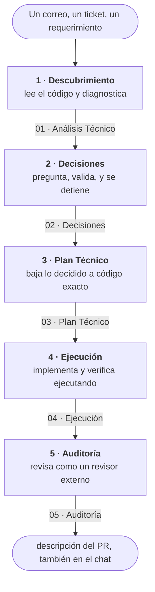

# mcp-phase-gate

*Léelo en [inglés](README.md) · Este es el README en español.*

Un servidor MCP (Model Context Protocol) que parte cada requerimiento en **cinco fases con compuerta** y obliga a que cada una deje su documento antes de pasar a la siguiente. En el panel de tu cliente se identifica como `mcp-phase-gate`.

## El problema

Le pides a un asistente de IA que implemente un requerimiento y hace lo que hacen todos: se lanza a escribir código. Rompe algo que no había leído. Toma en silencio decisiones que nunca te consultó. Y cuando cambias de chat, o te sientas en la otra computadora, el razonamiento entero se perdió — porque vivía en la conversación, y **la conversación no viaja**.

## Cómo lo resuelve

El asistente no llega a tocar código hasta la fase 4. Para entonces ya diagnosticó leyendo el repositorio, te preguntó lo que no podía decidir solo, y escribió un plan contrastado contra el código real. Cada fase deja un documento en una carpeta central, así que lo que se pensó sobrevive al chat y al dispositivo.



**La parada obligatoria está en la fase 2**: ahí se detiene y no avanza hasta que respondas. No es una sugerencia de que pregunte — es que la fase no cierra sin tus respuestas, y lo que decidas queda escrito con su fundamento.

Y entre una fase y otra hay una **compuerta**, que es lo que le da el nombre al servidor: si pides una fase saltándote la anterior, el servidor lo detecta y avisa ([ver abajo](#-la-compuerta-saltarse-una-fase-deja-de-ser-invisible)).

En la Fase 4 la IA hace el commit de cada lote solo con tu OK; nunca hace push ni abre el PR. En la Fase 5 solo lee.

## Para quién es

Para quien trabaja sobre **código que ya existe y no se puede romper**, y necesita que quede constancia de por qué se hizo cada cosa. Encaja especialmente si trabajas desde más de un equipo, o si te toca justificar decisiones semanas después.

No es para prototipos desechables ni para arrancar un proyecto de cero: cinco fases para cambiar un color es una ceremonia absurda.

Habla MCP estándar, así que funciona en cualquier cliente compatible. Está **probado en Cursor, VS Code y Claude Code** — ver [Instalación](#-instalación).

---

## 📁 Cómo se organiza la Documentación

Cada tarea vive dentro de una carpeta con esta estructura fija:

```
DOCUMENTACIÓN/
├── PROYECTO-A/
│   └── Proyectos/
│       └── <nombre_de_la_tarea>/
│           ├── 00 - Contexto Inicial.md   ← lo escribe start_task
│           ├── 01 - Análisis Técnico.md   ← Fase 1
│           ├── 02 - Decisiones.md         ← Fase 2
│           ├── 03 - Plan Técnico.md       ← Fase 3
│           ├── 04 - Ejecución/            ← Fase 4, con más de un lote: un recibo por lote
│           │   ├── L01 - <slug>.md
│           │   └── L02 - <slug>.md
│           ├── 04 - Ejecución.md          ← Fase 4: el recibo, o el índice de los recibos
│           └── 05 - Auditoría.md          ← Fase 5
├── PROYECTO-B/
│   └── Proyectos/
│       └── <nombre_de_la_tarea>/
└── PROYECTO-C/
    └── Proyectos/
        └── <nombre_de_la_tarea>/
```

`PROYECTO-A`, `PROYECTO-B` y `PROYECTO-C` son de ejemplo: tus proyectos son las carpetas que tú tengas ahí, con los nombres que tú les pongas. El nivel `Proyectos` es la subcarpeta de tareas, y su nombre también es configurable — ver `PHASE_GATE_TASKS_SUBDIR` más abajo.

**Lotes y recibos.** El plan de la Fase 3 parte el trabajo en lotes (`L01`, `L02`…): cada uno es un cambio que se revierte solo y deja la aplicación funcionando. La Fase 4 los ejecuta uno a la vez y cierra cada lote con un **recibo** corto (qué se hizo, qué se verificó, qué espera por ti) y un commit. Con un solo lote, el recibo es directamente `04 - Ejecución.md` y no hay subcarpeta, salvo que ese lote falle o se descarte: entonces su recibo va a `04 - Ejecución/` y la fase no se da por cerrada. Con varios, los recibos van en `04 - Ejecución/` y `04 - Ejecución.md` es el índice que se escribe al cerrar el último: hasta entonces la fase no aparece como terminada. Al pedir la Fase 4 o la 5, el servidor añade al prompt la lista de recibos que ya existen, para retomar en otro chat sin adivinar sus nombres.

> El servidor arma esta ruta **automáticamente**. Tú (o el LLM) solo indican `project`, `task_name` y `file_name`; no hay que escribir la ruta completa a mano.

---

## 💻 Instalación

Hay dos caminos, y llevan al mismo sitio:

- **Con `npx`** — nada que clonar ni compilar, y se actualiza solo. Es el recomendado si solo quieres usarlo.
- **Desde el código** — si vas a editar los prompts a mano o a contribuir al repo.

El código es idéntico en todos lados; lo único que cambia de un equipo a otro son **las rutas a tus carpetas**, porque el usuario del sistema y dónde tengas la documentación son distintos. Por eso se configuran por variable de entorno y no en el código.

### Requisitos previos
- **Node.js 22 o superior** instalado. Verifícalo con `node -v`. Es lo que declara el `package.json` y lo único que CI prueba (22 y 24); las versiones anteriores ya no tienen soporte.
- **Una carpeta para tu documentación**, disponible localmente. Si vive en una carpeta sincronizada (OneDrive, Google Drive, Dropbox, iCloud) viaja sola entre tus equipos, que es como se recomienda usarlo — pero no es obligatorio: al servidor solo le llega una ruta local y le da igual qué haya detrás.
- **Un cliente MCP**: Cursor, VS Code o Claude Code.
- **Git**, solo si vas por el camino desde el código.

---

### 🚀 Camino A — con `npx` (recomendado)

No hay nada que instalar: `npx` descarga el paquete la primera vez y lo cachea. Todo se configura en el archivo de tu cliente MCP.

**La clave que le pongas es la que identifica al servidor y la que prefija sus tools y sus comandos**, así que puedes ponerle la que quieras. En los ejemplos va `mcp-phase-gate`, igual que el nombre del paquete y el que el servidor declara de sí mismo. Si lo registras por primera vez, una clave corta como `pg` deja los comandos más cortos (`/pg:f1` en Claude Code). **Si ya lo tienes registrado, conserva tu clave**: cambiarla cambia el nombre de todas las tools y comandos, y tendrías que volver a conceder sus permisos.

Recuerda que en JSON cada `\` va doble `\\`.

<details open>
<summary><b>Cursor</b> — <code>C:\Users\&lt;TU_USUARIO&gt;\.cursor\mcp.json</code> (créalo si no existe)</summary>

```json
{
  "mcpServers": {
    "mcp-phase-gate": {
      "command": "npx",
      "args": ["-y", "mcp-phase-gate"],
      "env": {
        "PHASE_GATE_DOCS_PATH": "C:\\Users\\TU_USUARIO\\OneDrive - TU ORGANIZACIÓN\\Documentos\\DOCUMENTACIÓN",
        "PHASE_GATE_REPOS_PATH": "C:\\proyectos"
      }
    }
  }
}
```
</details>

<details>
<summary><b>VS Code</b> — <code>C:\Users\&lt;TU_USUARIO&gt;\AppData\Roaming\Code\User\mcp.json</code></summary>

Ojo con dos diferencias: la clave de arriba es `servers`, no `mcpServers`, y hay que declarar `type`.

```json
{
  "servers": {
    "mcp-phase-gate": {
      "type": "stdio",
      "command": "npx",
      "args": ["-y", "mcp-phase-gate"],
      "env": {
        "PHASE_GATE_DOCS_PATH": "C:\\Users\\TU_USUARIO\\OneDrive - TU ORGANIZACIÓN\\Documentos\\DOCUMENTACIÓN",
        "PHASE_GATE_REPOS_PATH": "C:\\proyectos"
      }
    }
  }
}
```
</details>

<details>
<summary><b>Claude Code</b> — de una sola línea</summary>

```bash
claude mcp add mcp-phase-gate --env PHASE_GATE_DOCS_PATH="C:\Users\TU_USUARIO\Documentos\DOCUMENTACIÓN" --env PHASE_GATE_REPOS_PATH="C:\proyectos" -- npx -y mcp-phase-gate
```

O a mano, en un `.mcp.json` en la raíz del proyecto, con la misma forma que el de Cursor.
</details>

Ese `PHASE_GATE_DOCS_PATH` es solo un **ejemplo** con una carpeta de OneDrive. Sirve igual `G:\Mi unidad\Documentación`, `D:\Dropbox\Docs` o `C:\Docs` sin nube ninguna.

> **Por este camino no hay archivo `.env`.** El paquete vive dentro de `node_modules`, donde no tiene sentido dejar tu configuración, así que las rutas van **obligatoriamente** en el bloque `"env"`. El `.env` solo existe en el camino de abajo.

**Las dos variables son obligatorias y no tienen valor por defecto.** Si falta alguna, o si apunta a una carpeta que no existe, las tools que la necesitan te lo dicen con ese nombre exacto en vez de fallar más tarde por otro motivo.

> **¿Ya lo usabas con `ORQUESTADOR_*`?** Esos nombres siguen funcionando como alias de `PHASE_GATE_*`; no tienes que tocar nada. Si defines los dos con valores distintos gana `PHASE_GATE_*`, y `doctor` y el log del servidor te avisan.

> `npx mcp-phase-gate` escrito directamente en una terminal **parece que se cuelga**, y no está roto: es un servidor MCP esperando mensajes por stdin. Si lo que quieres es comprobar tu instalación, usa `npx mcp-phase-gate doctor` ([ver abajo](#-revisar-la-instalación-doctor)).

---

### 🔧 Camino B — desde el código

Necesario solo si vas a editar los prompts del repo directamente o a contribuir. Para *añadir* prompts propios no hace falta: eso se hace superponiendo carpetas, [ver abajo](#-los-prompts-de-las-fases-viven-en-prompts).

**1. Clona y compila.** La carpeta `build/` NO se sube al repo, así que hay que generarla en cada dispositivo:

```bash
git clone https://github.com/Montse2308/mcp-phase-gate.git
cd mcp-phase-gate
npm install
npm run build
```

**2. Crea tu `.env`** con las rutas de ESTE equipo (no se sube al repo):

```bash
copy .env.example .env
```

Averigua tu ruta real abriendo la carpeta en el explorador y copiando la ruta de la barra de direcciones. Aquí las barras invertidas van **simples**, sin comillas:

```ini
PHASE_GATE_DOCS_PATH=C:\Users\TU_USUARIO\OneDrive - TU ORGANIZACIÓN\Documentos\DOCUMENTACIÓN
PHASE_GATE_REPOS_PATH=C:\proyectos
```

> Guarda el `.env` en **UTF-8** (con o sin BOM, da igual). Si lo creas desde PowerShell con `>` sale en UTF-16: el servidor lo detecta, no lo carga y te lo dice, tanto en el error de la variable que falta como en `doctor`.

**3. Registra el servidor** igual que en el camino A, pero cambiando `command` y `args` por el `build/index.js` de tu clon, y sin bloque `"env"` (las rutas ya vienen del `.env`):

```json
"command": "node",
"args": ["C:\\<DONDE_CLONASTE>\\mcp-phase-gate\\build\\index.js"]
```

En **Claude Code**, un `.mcp.json` en la raíz de este repo puede usar ruta **relativa** (`"args": ["build/index.js"]`), porque lo lanza desde esa carpeta. Es la única de las tres configuraciones que sirve igual en cualquier máquina.

> Si defines una variable en el `.env` y también en el bloque `"env"` del cliente, gana la del cliente.

---

### ✅ Verificar que funciona
1. Reinicia el cliente, o desactiva y vuelve a activar el servidor en su panel de MCP.
2. Debe aparecer activo con sus 9 tools listadas. En **Cursor** está en Settings → MCP; en **VS Code**, en la vista de extensiones/MCP; en **Claude Code**, con `/mcp`.
3. Pruébalo pidiendo en el chat: *"Usa la tool `get_orchestrator_status` del mcp-phase-gate"* — te devuelve la radiografía de la instalación: qué variables ve, qué prompts usa y qué proyectos encuentra.

### 🔍 Revisar la instalación: `doctor`

Desde una terminal, con las mismas variables que le das al cliente:

```bash
npx mcp-phase-gate doctor
```

Te dice qué versión corre y desde dónde (`npx`, global, una dependencia o un clon), qué valor tiene cada variable y de dónde salió (el entorno o el `.env`, y si usaste el nombre nuevo o el alias), qué archivo de prompt gana en cada fase, qué proyectos hay con su tarea activa, y una lista de hallazgos: una variable obligatoria que falta, un `.env` en UTF-16, un `global-rules.md` propio al que le faltan secciones que las fases citan, una fase sin documento… Sale con código `1` si hay algún error, así que sirve también en un script. `doctor --json` da lo mismo como JSON.

Es la misma información que devuelve la tool `get_orchestrator_status` y el recurso `phase-gate://estado`; desde el chat, además, incluye qué cliente está conectado y qué capacidades anunció.

---

## 🔄 Trabajar en varios dispositivos sin perder el hilo

- Si la **Documentación** vive en una carpeta sincronizada (OneDrive, Google Drive, Dropbox, iCloud), viaja sola entre tus equipos. Lo único distinto en cada uno es el archivo `.env` ([camino B](#-camino-b--desde-el-código), paso 2), que es local y no se sube al repo.
- El servidor recuerda cuál es la **tarea activa de cada proyecto** (ver `get_active_task`). Es un puntero por proyecto, no uno solo: puedes tener una ventana en un proyecto y otra en otro sin que se pisen. Ese registro es **local de cada dispositivo** y se guarda en la carpeta de datos de tu usuario, fuera del repo, así que sobrevive a borrar `build/` o volver a clonar:
  - **Windows:** `%APPDATA%\mcp-phase-gate\active-tasks.json`
  - **macOS:** `~/Library/Application Support/mcp-phase-gate/active-tasks.json`
  - **Linux:** `~/.local/state/mcp-phase-gate/active-tasks.json`

  Si cambias de equipo o de chat y el LLM "olvidó" dónde escribir, dile que llame `get_active_task` o simplemente indícale el `project` + `task_name`.
- **La fase no se guarda: se deduce.** El servidor mira qué documentos tiene ya la carpeta de la tarea y de ahí saca en qué fase vas, porque cada fase declara cómo se llama el suyo. Por eso el dato nunca se desincroniza: si borras `02 - Decisiones.md` porque quedó mal, la tarea vuelve sola a la Fase 2.
- Y si el archivo de punteros se pierde —equipo nuevo, o lo borraste—, `get_active_task` no se queda mudo: propone la tarea con actividad más reciente y **te avisa de que es una deducción**, para que la confirmes antes de escribir.
- **Regla de oro:** si usas una carpeta sincronizada, deja que termine de sincronizar antes de empezar a trabajar en el otro equipo, para no crear conflictos de archivos.

---

## 🗂 ¿Varias carpetas de Documentación? (opcional)

**Esto no es parte del flujo. Si con una carpeta te basta, sáltate la sección entera.**

Puede que quieras documentaciones separadas que no se mezclen: una del trabajo y otra de proyectos personales, por ejemplo, cada una en un sitio distinto —o una en la nube y otra no—. No hace falta nada nuevo: **registra el servidor más de una vez** en tu cliente, con un bloque `env` distinto en cada registro.

```jsonc
{
  "mcpServers": {
    "pg-trabajo": {
      "command": "npx",
      "args": ["-y", "mcp-phase-gate"],
      "env": {
        "PHASE_GATE_DOCS_PATH": "C:\\Users\\TU_USUARIO\\OneDrive - TU ORGANIZACIÓN\\Documentos\\DOCUMENTACIÓN",
        "PHASE_GATE_REPOS_PATH": "C:\\proyectos",
        "PHASE_GATE_STATE_PATH": "C:\\Users\\TU_USUARIO\\.orquestador\\trabajo"
      }
    },
    "pg-personal": {
      "command": "npx",
      "args": ["-y", "mcp-phase-gate"],
      "env": {
        "PHASE_GATE_DOCS_PATH": "G:\\Mi unidad\\Documentación",
        "PHASE_GATE_REPOS_PATH": "D:\\dev",
        "PHASE_GATE_TASKS_SUBDIR": "",
        "PHASE_GATE_STATE_PATH": "C:\\Users\\TU_USUARIO\\.orquestador\\personal"
      }
    }
  }
}
```

Es el mismo paquete en los dos: lo único que cambia son las rutas. Cada registro puede tener incluso su propia subcarpeta de tareas — arriba, la personal la deja vacía para que las tareas cuelguen directo del proyecto.

> ⚠️ **`PHASE_GATE_STATE_PATH` tiene que ser distinto en cada registro.** Si se comparte, los punteros de tarea activa se pisan **en silencio**: la clave del estado es el nombre del proyecto, así que dos documentaciones con un proyecto que se llame igual acaban compartiendo entrada y una le contesta a la otra. No da error; simplemente te responde la tarea equivocada.

Dos cosas más que muerden y no son evidentes:

- **Modo espejo, no streaming.** Google Drive en modo *streaming* y OneDrive con *Archivos a Petición* dejan los archivos como marcadores hasta que algo los abre. Este servidor vive de listar carpetas y comprobar si existen archivos, así que con marcadores se vuelve lento o falla cuando no hay red. Si puedes, ten la carpeta de Documentación **descargada localmente**.
- **Los repos de código, fuera de la carpeta sincronizada.** La Documentación en la nube no da problema. El código sí: la sincronización compitiendo con git sobre `.git/` corrompe repositorios. Que `PHASE_GATE_REPOS_PATH` apunte a un disco local.

---

## 🧩 Lo que vive FUERA del repo (una copia por dispositivo)

`git pull` **no** actualiza estas cuatro cosas. Si algo dejó de funcionar después de jalar
cambios, la causa está casi siempre aquí.

| Qué | Dónde | Por qué no está en el repo |
|-----|-------|----------------------------|
| El servidor compilado | `build/` en tu clon | Está gitignoreado. **Después de cada `git pull` que traiga cambios en `src/`, corre `npm run build`** o el cliente seguirá ejecutando la versión anterior. |
| Las rutas de este equipo | `.env` en la raíz ([camino B](#-camino-b--desde-el-código), paso 2) | Cambian el usuario del sistema y dónde tengas la carpeta de Documentación. |
| El registro del MCP | La configuración de tu cliente ([camino A](#-camino-a--con-npx-recomendado), o el paso 3 del [camino B](#-camino-b--desde-el-código)) | En Cursor y VS Code contiene la ruta absoluta a `build/index.js`, que depende de dónde clonaste y apunta a una carpeta gitignoreada. Ninguna ruta puede ser correcta en todos los equipos. Ver [`docs/decisiones.md`](docs/decisiones.md). La excepción es el `.mcp.json` de Claude Code, que va con ruta relativa. |
| Los comandos `/f1`–`/f5` como archivos, **solo si tu cliente no muestra bien los MCP Prompts** | `C:\Users\<TU_USUARIO>\.cursor\commands\f<N>.md` en Cursor | Desde la 2.2.0 el servidor los ofrece como MCP Prompts y llegan solos con cada versión ([ver abajo](#los-comandos-de-fase)). La copia en archivos solo hace falta como respaldo; en **Claude Code** dentro de este repo ya está versionada en `.claude/commands/`. |

### Los comandos de fase

Se invocan en el chat escribiendo `/f1`, `/f2`, etc. **Son solo orquestación**: dicen qué
tools llamar y en qué orden. El comportamiento, la estructura del documento y su nombre de
archivo los dicta el prompt de la fase en `prompts/`, así que afinar una fase no obliga a
tocar su comando.

Lo que hace cada uno:

| Comando | Llama a | Documento que deja |
|---------|---------|--------------------|
| `/f1` | `start_task` + `get_phase_prompt(1)` | El de la Fase 1 |
| `/f2` | `get_phase_prompt(2)`, lee el de la Fase 1 | El de la Fase 2, después de que respondas las preguntas |
| `/f3` | `get_phase_prompt(3)`, lee los anteriores | El de la Fase 3 |
| `/f4` | `get_phase_prompt(4)`, lee el plan | Un recibo por lote; el documento de la fase al cerrar |
| `/f5` | `get_phase_prompt(5)` | El de la Fase 5: la auditoría y la descripción del PR, que además van en el chat |

Ningún comando nombra un archivo: el nombre lo declara la cabecera del prompt de cada fase
y `get_phase_prompt` se lo entrega al modelo.

`/f1` necesita project, task_name y el requerimiento completo. `/f5` acepta un rango de
commits; si no le das ninguno, audita los que registran los recibos de la Fase 4, y solo si no
hay recibos te pregunta. Los demás arrancan de `get_active_task`.

**Llegan solos, como MCP Prompts.** Desde la 2.2.0 el servidor ofrece cada comando como un
prompt MCP (`f1`…`f5`), con su texto en [`prompts/comandos/`](prompts/comandos). No hay que
copiar nada a ninguna carpeta y se actualizan con cada versión del paquete. Todos sus
argumentos son opcionales —`project`; en `/f1` también `task_name` y `contexto`; en `/f5`,
`commits`—: lo que no pases te lo pide el propio comando, y un contexto largo puede ir pegado
después del comando como texto normal. Una fase que añadas tú (una `fase-6`) recibe su `/f6`
con un texto genérico, y un `comandos/fN.md` en tu carpeta de prompts propia gana al de
fábrica.

Cómo se ven en cada cliente:

| Cliente | `/f1`…`/f5` visibles | Argumentos con espacios | `@` recursos | Confirmaciones directas | Notas |
|---------|----------------------|-------------------------|--------------|-------------------------|-------|
| Claude Code | Por verificar (según su documentación: `/<clave>:f1 (MCP)`, y `/mcp__<clave>__f1` como alias) | Por verificar | Por verificar | Por verificar | |
| Cursor | Por verificar (según su documentación: en el menú de prompts MCP) | Por verificar | Por verificar | Por verificar | En Windows, `PHASE_GATE_ELICITATION=off` mientras siga abierto el bug del formulario ([ver abajo](#-documentos-protegidos)) |
| VS Code | Por verificar (su documentación se contradice entre `/<clave>.f1` y `mcp.<clave>.f1`) | Por verificar | Por verificar | Por verificar | |

**Si tu cliente no los muestra cómodamente**, usa los archivos: en este repo, Claude Code ya
los lee de [`.claude/commands/`](.claude/commands) (idénticos a `prompts/comandos/`); para
usarlos en tus otros proyectos, cópialos a `C:\Users\<TU_USUARIO>\.claude\commands\`, o a
`C:\Users\<TU_USUARIO>\.cursor\commands\` en Cursor. Más detalle en
[`docs/comandos-de-fase.md`](docs/comandos-de-fase.md).

---

## 🚦 La compuerta: saltarse una fase deja de ser invisible

Si pides una fase por delante de la que te toca, el prompt llega con un aviso al principio:

```
## ATENCIÓN — COMPUERTA DE FASE

Pediste la Fase 4, pero la tarea "login-sso" no tiene los documentos de fases anteriores:

- Fase 3: falta `03 - Plan Técnico.md`

Esta tarea va en la Fase 3 (Plan Técnico). NO hagas el trabajo de la Fase 4 sobre
documentos que no existen ni te los inventes a partir del contexto del chat.
```

**Avisa, no bloquea.** El prompt se entrega igual, así que el día que quieras saltarte una fase a propósito en un cambio trivial, puedes. Lo que cambia es que ya no pasa desapercibido.

Tres cosas que **no** hace, a propósito:

- **No estorba volver atrás.** Si vas en la Fase 5 y pides la 2 para corregir decisiones, eso no es saltarse nada y no dice nada. Solo mira huecos hacia atrás.
- **No te obliga a escribir nada más.** Sigues escribiendo `/f4` a secas. Quien averigua de qué tarea se habla es el servidor, con el puntero que ya mantiene — no el modelo preguntándotelo.
- **No se calla cuando no puede comprobar.** Si tienes varios proyectos con tarea activa y no se indicó cuál, lo dice en vez de fingir que todo está en orden.

**También señala los pendientes que dejó la fase anterior.** Si el documento de la fase anterior tiene una sección `## Validaciones pendientes` con algo dentro, o si al pedir la Fase 5 algún recibo de lote quedó `con pendientes`, `fallido` o `descartado`, el prompt llega además con un bloque `## PENDIENTES HEREDADOS (detectados por el servidor)` que los nombra, para que la IA te los diga antes de empezar. Una sección que solo dice "Ninguna." no cuenta. Tampoco bloquea nada: solo señala lo que el prompt ya obligaba a escribir.

---

## 🔒 Documentos protegidos

Cada fase trabaja sobre los documentos de las anteriores, así que reescribir uno ya superado cambia en silencio la base de lo que vino después. Por eso `write_central_doc` se niega, **sin `force: true`**, a escribir:

- **El contexto inicial** (`00 - Contexto Inicial.md`), siempre, incluso para crearlo. Solo `start_task` lo escribe sin `force`.
- **El documento de una fase congelada.** Una fase se congela en cuanto existe el documento de una fase posterior, o en cuanto la Fase 4 tiene algún recibo en `04 - Ejecución/`. Los recibos cuentan como de la Fase 4: a ellos y a `04 - Ejecución.md` solo los congela la Fase 5.

Crear un documento de fase que todavía no existe nunca se rechaza; un recibo nuevo sí, cuando la Fase 5 ya está presente. Los nombres se comparan sin distinguir mayúsculas y en la misma forma Unicode, así que escribirlos de otra manera no esquiva la protección.

**Si hace falta una corrección legítima** —una errata en el análisis con las decisiones ya escritas—, depende de tu cliente:

- **Si tu cliente admite confirmaciones directas** (elicitation de MCP), el servidor **te pregunta a ti**, en un formulario de tu cliente con una casilla: "Reescribir `01 - Análisis Técnico.md`". Si la marcas y aceptas, se escribe y la respuesta dice que fue con tu confirmación; si dices que no o cierras el formulario, no se escribe nada. Aquí `force` no basta: lo pone la IA, y justo eso es lo que la pregunta evita.
- **Si no la admite**, sigue como antes: el mensaje de rechazo le explica a la IA que necesita tu confirmación explícita en el chat y `force: true`, y la respuesta avisa de que el documento se sobrescribió (o se creó, si no existía).

Lo mismo para **estrenar un proyecto** con `crear_proyecto: true`: con confirmaciones directas, el servidor te pregunta antes de crear la carpeta.

Si tu cliente anuncia confirmaciones directas pero el formulario nunca aparece, el servidor espera tres minutos y no escribe nada; a la segunda vez seguida tampoco escribe (aunque la IA haya puesto `force`) y deja de preguntar durante el resto de la sesión: desde ahí vuelve a decidir `force`, con tu confirmación en el chat. Si tu cliente cancela la llamada antes de que respondas, no se escribe nada. Para evitarlo desde el principio, registra el servidor con `PHASE_GATE_ELICITATION=off`. **En Cursor para Windows se recomienda `off`** mientras siga abierto el bug en el que el formulario no aparece.

Además, `write_central_doc` solo escribe **dentro de la carpeta de una tarea que ya existe**: no crea carpetas sueltas en la Documentación.

---

## 🛠 Tools Disponibles

| Tool | Qué hace |
|------|----------|
| `start_task` | Crea la carpeta de una tarea **nueva** (`<PROYECTO>/Proyectos/<tarea>`), guarda el "00 - Contexto Inicial.md" y la deja como **activa de su proyecto**. Si la tarea ya existe se niega y te manda a `switch_task`, para no reescribir el contexto inicial. Estrenar un proyecto pide `crear_proyecto: true` y, si tu cliente puede, tu confirmación directa. |
| `get_active_task` | Devuelve la tarea activa y **en qué fase va**, deducida de los documentos que ya tiene. Sin `project` responde la de cada proyecto. Úsalo al abrir un chat nuevo o si se perdió el contexto. |
| `list_tasks` | Lista las tareas que existen y la fase de cada una, de la más reciente a la más antigua. Para retomar algo viejo o ver qué quedó a medias. |
| `switch_task` | Cambia cuál es la tarea activa de un proyecto. **No toca ningún archivo**: es la forma correcta de retomar una tarea que ya existe. |
| `get_phase_prompt` | Trae las reglas de comportamiento globales según la fase (1–5): 1 Descubrimiento, 2 Decisiones, 3 Plan Técnico, 4 Ejecución, 5 Auditoría / Pre-PR. El texto vive en `prompts/` (ver abajo). Comprueba de paso la **compuerta**: si pasas `project` y te saltaste una fase, el prompt llega con el aviso al principio, seguido de los pendientes heredados si los hay. |
| `read_central_doc` | Lee un archivo de la Documentación. **Recomendado:** pasar `project` + `task_name` + `file_name` (el servidor arma la ruta). También acepta `file_path` relativo. |
| `write_central_doc` | Escribe/sobrescribe un archivo dentro de la carpeta de una tarea. Mismos parámetros que `read_central_doc` + `content`, y `force` para los [documentos protegidos](#-documentos-protegidos) cuando tu cliente no admite confirmaciones directas. |
| `read_cross_repo` | Lee archivos de otros repos locales en tu carpeta de proyectos (ej. desde `repo-a` consultar cómo `repo-b` maneja un endpoint) sin cambiar de ventana. |
| `get_orchestrator_status` | La radiografía de la instalación, igual que [`doctor`](#-revisar-la-instalación-doctor): versión y ruta del paquete, variables y de dónde salió cada una, qué prompt gana en cada fase, proyectos con su tarea activa y avisos. Además, el cliente conectado y sus capacidades. Úsala cuando algo no se comporte como esperas. |

Todas declaran sus anotaciones MCP (solo lectura, destructiva, idempotente), así que un cliente cauto puede dejar pasar sin preguntar las de lectura. Solo `write_central_doc` es destructiva.

### Recursos `phase-gate://`

El servidor expone además los documentos como **recursos de solo lectura**, que los clientes compatibles muestran al escribir `@` en el chat para adjuntarlos sin pedírselo a la IA:

| Recurso | Qué es |
|---------|--------|
| `phase-gate://estado` | La radiografía de `doctor`, en Markdown |
| `phase-gate://fases` | Las fases disponibles, con su documento, sus recibos y qué archivo de prompt gana |
| `phase-gate://tareas/{proyecto}/{tarea}/{documento}` | Un documento de una tarea |
| `phase-gate://tareas/{proyecto}/{tarea}/recibos/{recibo}` | Un recibo de lote de la Fase 4 |

La lista solo incluye los documentos que existen de la **tarea activa de cada proyecto**, para no inundar el selector; el resto se alcanza con la plantilla, que autocompleta proyecto, tarea y documento. Tienen las mismas defensas que `read_central_doc`: no se salen de la carpeta de la tarea, no exponen archivos con punto y no leen más de 1 MB.

### Cómo el servidor arma las rutas
- **Documentación:** `PHASE_GATE_DOCS_PATH` / `<PROYECTO>` / `PHASE_GATE_TASKS_SUBDIR` / `<tarea>` / `<archivo>`
- **Repos de código:** `PHASE_GATE_REPOS_PATH` / `<repo>` / `<archivo>`

### Qué cuenta como proyecto

No hay ninguna lista de proyectos que mantener. **Es proyecto la carpeta que contenga la subcarpeta de tareas**, así que dar de alta uno nuevo es crearle esa subcarpeta y ya. Las carpetas que no la tengan —credenciales, material compartido, archivo muerto— quedan fuera solas.

Un proyecto que no existe se rechaza mostrando la lista de los que sí, en vez de crear una carpeta suelta. Para **estrenar** un proyecto hay que pedirlo a propósito: `start_task` acepta `crear_proyecto: true`, y sin esa bandera un nombre mal escrito no ensucia tu Documentación.

> Si dejas `PHASE_GATE_TASKS_SUBDIR` vacío, la regla no se puede aplicar y **cualquier** carpeta cuenta como proyecto.

---

## 📝 Los prompts de las fases viven en `prompts/`

El texto de cada fase **ya no está dentro del código**: son archivos markdown sueltos.

```
prompts/
├── global-rules.md              ← reglas "Cero Rupturas", se anteponen a TODAS las fases
├── fase-1-descubrimiento.md
├── fase-2-decisiones.md
├── fase-3-plan-tecnico.md
├── fase-4-ejecucion.md
├── fase-5-auditoria-pr.md       ← incluye el contrato de la descripción del PR
└── comandos/                    ← el texto de /f1…/f5, que el servidor sirve como MCP Prompts
    ├── f1.md
    └── …
```

**Se leen en cada llamada.** Si editas un `.md`, la siguiente vez que la IA invoque
`get_phase_prompt` ya recibe la versión nueva — sin `npm run build` y sin reiniciar el
cliente. Eso permite afinar el comportamiento de una fase probándolo al momento.

Cada fase declara, en una cabecera al inicio del `.md`, cómo se llama el documento que produce:

```markdown
---
documento: 02 - Decisiones.md
---

# Decisiones
```

`get_phase_prompt` lee esa cabecera y le entrega al modelo, al final del prompt, el nombre exacto del documento de la fase y los de las fases anteriores. **Por eso los comandos `/f1`–`/f5` ya no nombran ningún archivo:** el nombre vive en un solo sitio, y cambiar un prompt no obliga a editar además un comando en cada dispositivo.

La fase 1 declara además `documento_inicial`, que es el archivo que escribe `start_task` con el contexto.

Reglas del formato:
- El archivo debe llamarse `fase-<N>-<lo-que-sea>.md` (también acepta `phase-<N>-...`).
- La cabecera es opcional y no se filtra al prompt: se quita antes de entregarlo.
- **El número de fases no está cableado:** si agregas un `fase-6-despliegue.md`, la
  fase 6 existe de inmediato.
- El primer encabezado `# Título` del archivo es el nombre que aparece en la
  descripción de la tool.
- `global-rules.md` se antepone automáticamente al contenido de la fase.

### Usar tus propios prompts sin perder los de fábrica

`PHASE_GATE_PROMPTS_PATH` apunta a una carpeta tuya que **se superpone** a la del paquete. No la sustituye.

Si quieres cambiar solo la Fase 2, tu carpeta lleva **un archivo**:

```
mis-prompts/
└── fase-2-a-mi-manera.md
```

Con eso, la Fase 2 es la tuya y las fases 1, 3, 4 y 5 siguen siendo las del paquete — incluidas las mejoras que traigan las versiones nuevas. Antes esto era reemplazo total: para cambiar una fase había que copiar las seis, quedarte con copias congeladas y, si se te olvidaba una, esa fase **desaparecía sin avisar**.

Tres detalles que importan:

- **Se superpone por número de fase, no por nombre de archivo.** Tu `fase-2-a-mi-manera.md` pisa al `fase-2-decisiones.md` del paquete. No tienes que adivinar cómo se llama el original.
- **También sirve para añadir.** Un `fase-6-despliegue.md` en tu carpeta crea la fase 6, sin tocar nada más.
- **Tu `global-rules.md` sustituye al del paquete, no se suma.** Concatenar dos juegos de reglas hace imposible saber de qué archivo salió la instrucción que estorbó, justo cuando necesitas saberlo. Si quieres las de fábrica y algo más, cópialas y añade.
  **Ojo:** las de fábrica traen las secciones `EVIDENCIA`, `BASE DE CADA DECISIÓN` y `PENDIENTES HEREDADOS`, que las fases citan. Un `global-rules.md` propio que no las incluya deja a las fases citando reglas que no existen; cópialas a tu archivo.

Por el camino `npx` esta es la **única** forma de personalizar: los prompts de fábrica viven dentro de `node_modules` y editarlos ahí no sirve, porque la siguiente instalación se los lleva.

### El contrato de la descripción del PR (Fase 5)

La Fase 5 no solo audita: redacta la descripción del PR bajo un contrato estricto,
para que el resultado sea consistente sin importar qué modelo de IA se use.

- **Título:** `tipo(área): frase`, y ahí termina — nada de números de ticket.
- **Estructura fija:** por qué (`Problema` si algo estaba roto, `Contexto` si es
  nuevo) → `Cambios` agrupados → secciones de cierre.
- **Las secciones de cierre son condicionales**, cada una con su disparador:
  `Alcance` solo si tocaste código existente, `Verificación` solo si la prueba fue
  sustanciosa, `Notas de despliegue` solo si hay migraciones.
- **El criterio para agrupar los bullets depende de la forma del cambio** (por
  componente, por sub-feature, por dimensión del dato…), con una tabla de decisión
  en el prompt. Así la descripción se adapta al tamaño del ticket sin dejar de ser
  predecible.
- **Límites de longitud en palabras**, no adjetivos: trivial (60–100), chico
  (120–160), normal (200–260), grande (350–450, tope 500).
- **Se entrega dentro de un bloque de código de cuatro backticks**, para que al
  copiar y pegar en GitHub llegue el markdown en crudo y no el texto ya renderizado.

Si quieres adaptarlo a tu estilo, edita `prompts/fase-5-auditoria-pr.md`. Lo que más
mueve la aguja es cambiar los ejemplos de la sección "EJEMPLOS DE REFERENCIA" por
descripciones de PR tuyas: el modelo imita esa voz más que cualquier instrucción.

> El porqué de cada regla del contrato está en [`docs/decisiones.md`](docs/decisiones.md).
> Léelo antes de cambiar algo: varias reglas que parecen arbitrarias resuelven un problema
> concreto.

---

## ⚙ Variables de entorno

Se cargan desde el archivo `.env` de la raíz del repo (o desde el bloque `"env"` del `mcp.json`).

Las dos primeras **son obligatorias y no tienen valor por defecto**: apuntan a carpetas que solo existen en tu equipo, así que cualquier default sería la ruta de la máquina de otra persona. Si falta una, o apunta a algo que no existe o que no es una carpeta, las tools que la usan devuelven el nombre de la variable y dónde configurarla. Las que no dependen de ella —como `get_phase_prompt`— siguen funcionando.

Cada variable tiene además un **alias** con el nombre de antes, `ORQUESTADOR_*` (por ejemplo, `ORQUESTADOR_DOCS_PATH`), que sigue funcionando para no romper ninguna configuración. Si defines los dos con valores distintos gana `PHASE_GATE_*`, y `doctor` y el log del servidor te avisan.

| Variable | Por defecto | Descripción |
|----------|-------------|-------------|
| `PHASE_GATE_DOCS_PATH` | **ninguno, es obligatoria** | Ruta a la carpeta raíz de la Documentación. Sincronizada o no, da igual. **Distinta en cada dispositivo.** |
| `PHASE_GATE_REPOS_PATH` | **ninguno, es obligatoria** | Ruta a la carpeta donde están tus repositorios de código. |
| `PHASE_GATE_TASKS_SUBDIR` | `Proyectos` | Subcarpeta donde viven las tareas dentro de cada proyecto. Vacía = las tareas cuelgan directo del proyecto. Es además la regla que decide qué carpeta cuenta como proyecto (ver abajo). |
| `PHASE_GATE_PROMPTS_PATH` | ninguno | Carpeta de prompts propios, que **se superponen** a los del paquete en vez de reemplazarlos: basta con poner los archivos de las fases que quieras cambiar ([ver arriba](#usar-tus-propios-prompts-sin-perder-los-de-fábrica)). |
| `PHASE_GATE_STATE_PATH` | Carpeta de datos del usuario (ver arriba) | Carpeta donde se guardan los punteros de tarea activa. Casi nunca hace falta tocarla; sirve para aislar el estado en pruebas y es **obligatoria si registras el servidor más de una vez** (ver [¿Varias carpetas de Documentación?](#-varias-carpetas-de-documentación-opcional)). |
| `PHASE_GATE_ELICITATION` | ninguno (activadas) | `off` (o `false`, `0`, `no`) para que el servidor no pida [confirmaciones directas](#-documentos-protegidos) al cliente y decida `force`, como antes. Recomendado en Cursor para Windows. No tiene alias. |

---

## 🧑‍💻 Desarrollo (si modificas el código)

> **Ojo:** esto aplica solo a cambios en el **código**. Si lo único que tocaste fue
> un prompt de `prompts/*.md`, **no hace falta compilar ni reiniciar nada** — se leen
> en cada llamada.

El código fuente está en `src/`, repartido por responsabilidad:

| Archivo | De qué se encarga |
|---------|-------------------|
| `config.ts` | Variables del entorno y su alias, lectura del `.env`, dónde vive el estado, identidad del servidor |
| `paths.ts` | Cómo se arma cada ruta y la comprobación de que no se salga de su base |
| `phases.ts` | Descubrir las fases y armar el prompt de cada una |
| `tasks.ts` | Qué tareas existen, en qué fase va cada una, cuál está activa, la compuerta y los pendientes heredados |
| `schemas.ts` | Los argumentos de cada tool, con su descripción y su mensaje de error |
| `servidor.ts` | Las tools del servidor. No calcula nada: traduce entre el protocolo y lo anterior |
| `recursos.ts` | Los recursos `phase-gate://` |
| `prompts-mcp.ts` | Los comandos `/f1`…`/fN` como MCP Prompts |
| `confirmacion.ts` | Las confirmaciones directas al usuario (elicitation) |
| `diagnostico.ts` | La radiografía que comparten `doctor`, `get_orchestrator_status` y `phase-gate://estado` |
| `cli.ts` | La línea de comandos: `doctor`, `--help`, `--version` |
| `log.ts` | El log: stderr y, con un cliente conectado, notificaciones MCP |
| `index.ts` | El punto de entrada: la línea de comandos, o el servidor por stdio |

El cliente ejecuta la versión compilada `build/index.js`, así que después de cualquier cambio:

```bash
npm run build
```

Y luego reinicia el MCP en tu cliente para que cargue la nueva versión.

Scripts disponibles:
- `npm run build` → compila TypeScript a `build/`.
- `npm test` → compila los tests y los corre con el runner de Node (necesita **Node 22 o superior**).
- `npm start` → ejecuta el servidor compilado.
- `npm run dev` → recompila a `build/` con cada cambio (`tsc --watch`).

Los tests viven en `test/` y no necesitan ninguna dependencia extra: usan `node:test`, que
viene con Node. Montan una Documentación Central de mentira en una carpeta temporal, así que
no tocan la tuya. El CI los corre en cada PR.

### Dónde está cada cosa

| Qué buscas | Dónde |
|------------|-------|
| Lo que el proyecto hace hoy | Este README (y su gemelo en inglés, [`README.md`](README.md) — **si cambias uno, cambia el otro**) |
| Por qué está diseñado así | [`docs/decisiones.md`](docs/decisiones.md) |
| Los comandos `/f1`–`/f5` | Su texto en [`prompts/comandos/`](prompts/comandos); cómo llegan a cada cliente en [`docs/comandos-de-fase.md`](docs/comandos-de-fase.md) |
| Que un cambio no rompió nada | [`test/`](test), con `npm test`. El CI los corre en cada PR |
| Lo que falta por hacer | [Issues](https://github.com/Montse2308/mcp-phase-gate/issues) — agrupados con las labels `v1-uso-propio` y `v2-publico` |
| Lo que ya se hizo | El historial de commits y los PRs mergeados |

---

## 📄 Licencia

[MIT](LICENSE).
