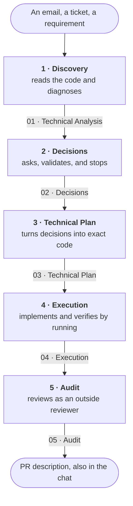
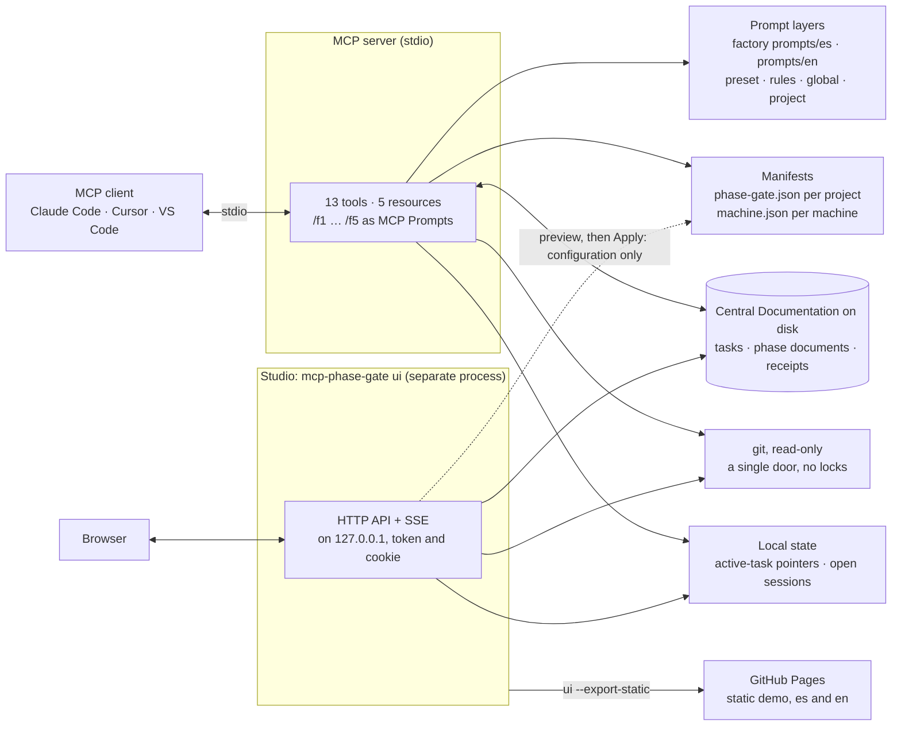

# mcp-phase-gate

An MCP server that turns any AI coding agent into a gated, auditable, batch-by-batch engineering workflow.

*This is the main README, in English · Read it in [Spanish](README.es.md).*

<p align="center">
  <a href="https://montse2308.github.io/mcp-phase-gate/medios/demo-en.mp4"></a>
</p>

[](https://github.com/Montse2308/mcp-phase-gate/actions/workflows/ci.yml)
[](https://www.npmjs.com/package/mcp-phase-gate)
[](https://www.npmjs.com/package/mcp-phase-gate#provenance)
[](https://github.com/Montse2308/mcp-phase-gate/blob/master/LICENSE)
[](https://montse2308.github.io/mcp-phase-gate/)

**Problem:** an AI coding agent jumps straight to code, makes decisions nobody asked it to make, and its reasoning dies with the chat.<br>
**Solution:** five phases with a gate between them, each one leaving a document on disk; in phase 4 the server itself writes each batch's receipt after checking the commit against git.<br>
**See it:** the [live demo](https://montse2308.github.io/mcp-phase-gate/) is the Studio on example data, read-only, in English and Spanish.

## Try it in 10 seconds

```bash
npx mcp-phase-gate ui --demo
```

It opens the Studio in your browser on a demo generated in a temporary folder (three projects, real git commits); it doesn't touch your documentation. `--idioma en` or `--idioma es` picks the demo's language; without it, `PHASE_GATE_LANG` or the system's decides.

---

An MCP (Model Context Protocol) server that splits every incoming requirement into **five gated phases**, and forces each one to leave a written document behind before the next can start. Your client's panel will show it as `mcp-phase-gate`.

## The problem

You ask an AI assistant to implement a requirement and it does what they all do: it starts writing code. It breaks something it never read. It quietly makes decisions it never asked you about. And when you switch chats, or sit down at your other machine, the entire reasoning is gone — because it lived in the conversation, and **conversations don't travel**.

## How it solves it

The assistant doesn't get to touch code until phase 4. By then it has diagnosed the problem by reading the repository, asked you what it couldn't decide alone, and written a plan checked against the real code. Every phase leaves a document in a central folder, so the thinking outlives both the chat and the device.



**The mandatory stop is phase 2**: it halts there and will not move on until you answer. This isn't a polite suggestion to ask questions — the phase does not close without your answers, and whatever you decide gets written down with its rationale.

And between one phase and the next there is a **gate**, which is what gives the server its name: ask for a phase while skipping the previous one and the server notices and warns you ([see below](#-the-gate-skipping-a-phase-stops-being-invisible)).

In phase 4 the AI commits each batch only with your OK (that's the default policy; a project can choose another, [see below](#-per-project-configuration)); it never pushes or opens the PR, under any policy. Each batch's receipt is written by the server, which checks against git that its commit exists and is on the branch ([see below](#-phase-4-with-the-server-record_batch)). In phase 5 it only reads.

Since 3.0 the flow adapts to the kind of work through **presets**: code with or without a test suite, a requirement that spans several repositories, maintaining an AI agent, or research whose deliverable is a report. The five phases and their gate stay the same; only the sections that need to change do. Since 3.2 everything works in **English and Spanish**: prompts, presets, server messages and the Studio ([see below](#-languages)).

## Who it's for

For people working on **code that already exists and must not break**, who need a record of why each thing was done. It fits especially well if you work from more than one machine, or if you have to justify decisions weeks later.

It is not for throwaway prototypes or greenfield projects: five phases to change a colour is absurd ceremony.

It speaks standard MCP, so it works with any compatible client. It is **tested on Cursor, VS Code and Claude Code** — see [Installation](#-installation).

---

## 📐 Architecture



- **The server** talks to the client over stdio and keeps almost no state of its own (one active-task pointer per project): the phase of a task is deduced from which documents exist on disk, the prompt is assembled from its layers on every call, and git is queried through one read-only door that takes no locks and runs nothing a repo brings along.
- **The Central Documentation** is a plain folder you own (synced or not). The server only writes inside task folders, and phase 4's receipts only through `record_batch`.
- **The Studio** is a separate process, loaded only by `ui`: a local HTTP API with live events (SSE) over the same functions the tools use. It never writes task documents or receipts. `--export-static` turns it into the read-only site published on GitHub Pages.

Every design choice is recorded with its reason and the alternative it discarded in [`docs/decisiones.md`](docs/decisiones.md), the **architecture decision record**: 100 entries, newest first (in Spanish).

---

## 📁 How the documentation is organised

Every task lives in a folder with this fixed structure (here, a project in English):

```
DOCUMENTATION/
├── PROJECT-A/
│   ├── phase-gate.json                  ← optional: the project's manifest
│   └── Proyectos/
│       └── <task_name>/
│           ├── 00 - Initial Context.md      ← written by start_task
│           ├── 01 - Technical Analysis.md   ← Phase 1
│           ├── 02 - Decisions.md            ← Phase 2
│           ├── 03 - Technical Plan.md       ← Phase 3
│           ├── 04 - Execution/              ← Phase 4: one receipt per batch (written by the server)
│           │   ├── L01 - <slug>.md
│           │   └── L02 - <slug>.md
│           ├── 04 - Execution.md            ← Phase 4: generated by the server when the last batch closes
│           └── 05 - Audit.md                ← Phase 5
├── PROJECT-B/
│   └── Proyectos/
│       └── <task_name>/
└── PROJECT-C/
    └── Proyectos/
        └── <task_name>/
```

The `Proyectos` level is the tasks subfolder, and its name is configurable (`Projects`, or empty) — see `PHASE_GATE_TASKS_SUBDIR` below. The document names come from the phase prompts of the project's language: a project in Spanish has `00 - Contexto Inicial.md`, `01 - Análisis Técnico.md`… `04 - Ejecución/` and `05 - Auditoría.md` ([see the table](#-languages)). A project never mixes the two.

**Batches and receipts.** The phase 3 plan splits the work into batches (`L01`, `L02`…): each one is a change that can be reverted on its own and leaves the application working. Phase 4 runs them one at a time, and each batch leaves a short **receipt** (what was done, what was verified, what is waiting for you) in `04 - Execution/`, written by the server with `record_batch`, and a commit. When the last batch closes, the server generates `04 - Execution.md`: with several batches it's the index of the receipts; with a single one, the receipt itself, moved there. Until then the phase doesn't show as finished ([how it works](#-phase-4-with-the-server-record_batch)). When you ask for phase 4 or 5, the server appends the list of existing receipts to the prompt, so a new chat can pick up without guessing their names.

> The server builds this path **automatically**. You (or the LLM) only supply `project`, `task_name` and `file_name`; nobody has to type a full path.

---

## 🌐 Languages

Prompts, commands, rule variants and presets ship in Spanish and English (`prompts/es/`, `prompts/en/`, `presets/es/`, `presets/en/`). Two different things have a language:

| What | Where it's declared | What it decides |
|---|---|---|
| **The project's language** | `"idioma": "es"` or `"en"` in its `phase-gate.json` | Which factory prompts and presets it uses, the document names, and the language the server writes in: receipts, the index, and the blocks it appends to a prompt |
| **A task's writing language** | `redaccion` in `start_task` (`"es"` or `"en"`), stored in the initial context's header | Only the language the AI writes the documents' **content** in. The prompt gains one line at the end; names, headings and keys stay as they are |

**How a project's language is resolved**, in this order:

1. `idioma` in its `phase-gate.json`.
2. **The documents it already has on disk**: tasks with `01 - Análisis Técnico.md` are Spanish, tasks with `01 - Technical Analysis.md` are English. With both, the one with more documents (a tie goes to Spanish), and `doctor` reports `IDIOMA-MIXTO`.
3. `idiomaPorDefecto` in this machine's `machine.json`.
4. `PHASE_GATE_LANG` (`es` or `en`; `es-MX` or `en_US.UTF-8` also work).
5. The system locale: `es` if it starts with `es`, otherwise `en`. Except when the project has a `phase-gate.json` without `idioma`, like the ones 3.0 and 3.1 wrote: that project is Spanish.

The disk goes before the machine on purpose: projects from 2.x have no manifest and are in Spanish, and opening one on a machine set to English must not make its tasks look like they have no phases done. `doctor` shows where each project's language comes from. `init --migrate` writes `idioma` into the manifests it creates (the one of the project's documents if it has any, otherwise `--idioma` or your answer to its question) and adds it, with a backup, to existing ones that lack it; while it's missing, `doctor` reports `MANIFIESTO-SIN-IDIOMA`. Without a project, the machine's language rules: if you work in Spanish on a machine set to English, set `PHASE_GATE_LANG=es` in your client's `env` block.

| Phase | Spanish project | English project |
|---|---|---|
| — | `00 - Contexto Inicial.md` | `00 - Initial Context.md` |
| 1 | `01 - Análisis Técnico.md` | `01 - Technical Analysis.md` |
| 2 | `02 - Decisiones.md` | `02 - Decisions.md` |
| 3 | `03 - Plan Técnico.md` | `03 - Technical Plan.md` |
| 4 | `04 - Ejecución.md` and `04 - Ejecución/` | `04 - Execution.md` and `04 - Execution/` |
| 5 | `05 - Auditoría.md` | `05 - Audit.md` |

**Changing a project's language renames nothing.** If the manifest declares one language and some tasks have documents in the other, `doctor` reports `IDIOMA-CON-TAREAS` and `get_phase_prompt` refuses with the same message, because otherwise those tasks would look empty. Put the manifest back, or rename those folders by hand.

**A task in the other language.** In a Spanish project, `start_task` with `redaccion: "en"` creates the task with the project's Spanish names and structure, and the prompt asks the AI to write the content in English. The reverse works the same way.

**The server's own messages.** Errors and responses, `doctor`, `--help`, `init`, `eject` and the descriptions of the tools and their parameters exist in both languages. A call that resolves a project answers in that project's language; otherwise `PHASE_GATE_LANG` decides, and last the system. Tool and parameter descriptions are fixed when the server starts, because the client asks for them once, when it connects. MCP clients often launch the server with a reduced environment, and on Windows Node follows the region settings, so say it explicitly in the client's `env` block: `"PHASE_GATE_LANG": "en"`, or `"es"` if you work in Spanish.

**What is never translated:** the names of the tools (`start_task`, `record_batch`…) and of their parameters (`titulo`, `que_se_hizo`, `cerrar_fase`…), batch ids `L01…L99`, slot ids, preset names, commit policies, manifest keys, environment variables and `doctor`'s finding codes. To make that easier:

- `crear_proyecto` also accepts the alias `create_project`.
- `record_batch` accepts `estado` in English: `verified`, `with pending items`, `failed`, `discarded`.
- Every slot keeps its canonical Spanish id and has an English alias, accepted in blocks, slot markers and `eject`: `phase-3/tests` → `fase-3/pruebas`, `global/zero-breakage` → `global/cero-rupturas`… The full table is in [`docs/glosario.md`](docs/glosario.md).
- Receipts, plans and headings are read in both languages: a receipt written in Spanish still reads in a project opened in English.

**The English prompts are not a machine translation.** Each file was rewritten with a fixed glossary ([`docs/glosario.md`](docs/glosario.md)), with the same slots in the same order and the same number of `FORBIDDEN` and `SELF-CHECK` points as its Spanish twin. A contract test checks that every heading the code looks for is there, and a golden test (`test/oro/3.2.0-en/`) pins the assembled English prompts; the Spanish golden tests did not change.

**The Studio has its own language**, independent of each project's: an ES / EN selector in the top bar, remembered by the browser; a shareable link with `#?lang=en`; otherwise the browser's languages, and last English. `<html lang>` follows it, and documents are shown as they were written ([see below](#-the-studio-see-the-flow-in-your-browser-ui)).

---

## 💻 Installation

Two routes, same destination:

- **With `npx`** — nothing to clone or build, and it updates itself. Recommended if you just want to use it.
- **From source** — if you're going to edit the prompts in place, or contribute.

The code is identical everywhere; the only thing that changes between machines is **the paths to your folders**, because the system user and where you keep your documentation differ. That's why they are environment variables and not constants in the code.

**The shortcut: `init`.** It registers the server in the clients it finds on your machine (Claude Code, Cursor, VS Code), with your paths:

```bash
npx mcp-phase-gate init --docs "C:\Users\YOUR_USER\Documents\DOCUMENTATION" --repos "C:\projects"
```

Without `--docs` and `--repos` it takes the variables or asks you. If the server was already registered, **it neither duplicates it nor changes its key**: it updates that entry, shows you the diff and asks for confirmation (`--yes` to skip asking). Before writing it leaves a `.bak` copy, it won't touch an `mcp.json` it can't parse (it prints the block for you to paste by hand), and with `--dry-run` it only tells you what it would do. `--cliente cursor` (or `claude-code`, `vscode`, `todos`) picks the client; `--comandos` also copies `/f1`…`/f5` as files, and `--migrate` prepares your projects for 3.0 ([see the guide](#-migrating-to-30-in-3-steps)). At the end it explains how to put a lock on `git push`, being honest about which option is a real boundary and which isn't, and runs `doctor`.

If you'd rather do it by hand, the two routes below.

### Prerequisites
- **Node.js 22 or newer.** Check with `node -v`. That's what `package.json` declares and the only thing CI tests (22 and 24); earlier versions are out of support.
- A folder for your central documentation, available locally. If it lives in a synced folder (OneDrive, Google Drive, Dropbox, iCloud) it travels between your machines on its own — that's the recommended setup, but not a requirement: the server only ever receives a local path and doesn't know what's behind it.
- **An MCP client**: Cursor, VS Code or Claude Code.
- **Git**, only for the from-source route.

---

### 🚀 Route A — with `npx` (recommended)

Nothing to install: `npx` fetches the package the first time and caches it. Everything is configured in your MCP client's file.

**The key you give it is what identifies the server and prefixes its tools and commands**, so you can name it whatever you like. The examples use `mcp-phase-gate`, the same as the npm package and the name the server reports for itself. If you're registering it for the first time, a short key such as `pg` keeps the commands short (`/pg:f1` in Claude Code). **If it's already registered, keep your key**: changing it renames every tool and command, and you'd have to grant their permissions again.

Remember that in JSON every `\` must be doubled as `\\`.

<details open>
<summary><b>Cursor</b> — <code>~/.cursor/mcp.json</code> (create it if missing)</summary>

```json
{
  "mcpServers": {
    "mcp-phase-gate": {
      "command": "npx",
      "args": ["-y", "mcp-phase-gate"],
      "env": {
        "PHASE_GATE_DOCS_PATH": "C:\\Users\\YOUR_USER\\OneDrive - YOUR ORGANISATION\\Documents\\DOCUMENTATION",
        "PHASE_GATE_REPOS_PATH": "C:\\projects",
        "PHASE_GATE_LANG": "en"
      }
    }
  }
}
```
</details>

<details>
<summary><b>VS Code</b> — <code>%APPDATA%\Code\User\mcp.json</code></summary>

Two differences to watch: the top-level key is `servers`, not `mcpServers`, and `type` must be declared.

```json
{
  "servers": {
    "mcp-phase-gate": {
      "type": "stdio",
      "command": "npx",
      "args": ["-y", "mcp-phase-gate"],
      "env": {
        "PHASE_GATE_DOCS_PATH": "C:\\Users\\YOUR_USER\\OneDrive - YOUR ORGANISATION\\Documents\\DOCUMENTATION",
        "PHASE_GATE_REPOS_PATH": "C:\\projects",
        "PHASE_GATE_LANG": "en"
      }
    }
  }
}
```
</details>

<details>
<summary><b>Claude Code</b> — one line</summary>

```bash
claude mcp add mcp-phase-gate --env PHASE_GATE_DOCS_PATH="C:\Users\YOUR_USER\Documents\DOCUMENTATION" --env PHASE_GATE_REPOS_PATH="C:\projects" --env PHASE_GATE_LANG=en -- npx -y mcp-phase-gate
```

Or by hand, in a `.mcp.json` at the project root, shaped like the Cursor one.
</details>

That `PHASE_GATE_DOCS_PATH` is only an **example** using a OneDrive folder. `G:\My Drive\Documentation`, `D:\Dropbox\Docs` or plain `C:\Docs` with no cloud at all work just as well.

`PHASE_GATE_LANG` is optional: it sets the language of the tool descriptions and of the messages that don't belong to a project, and of new projects with nothing else to go by. Use `"es"` if you work in Spanish ([see Languages](#-languages)).

> **There is no `.env` on this route.** The package lives inside `node_modules`, which is no place to keep your configuration, so the paths go in the `"env"` block — that's the only option here. The `.env` file only exists on the route below.

**Both path variables are required and have no default value.** If one is missing, or points at a folder that doesn't exist, the tools that need it say so by name instead of failing later for some unrelated-looking reason.

> **Already using it with `ORQUESTADOR_*`?** Those names keep working as aliases of `PHASE_GATE_*`; there's nothing to change. If you define both with different values, `PHASE_GATE_*` wins, and `doctor` and the server log tell you.

> Typing `npx mcp-phase-gate` straight into a terminal **looks like it hangs**, and nothing is broken: it's an MCP server waiting for messages on stdin. If you want to check your setup, run `npx mcp-phase-gate doctor` ([see below](#-check-your-setup-doctor)).

---

### 🔧 Route B — from source

Only needed if you're going to edit the repo's prompts directly, or contribute. You do *not* need it to add prompts of your own: that's done by layering folders, [see below](#-the-phase-prompts-live-in-promptslanguage).

**1. Clone and build.** `build/` is **not** committed, so it has to be generated on every machine:

```bash
git clone https://github.com/Montse2308/mcp-phase-gate.git
cd mcp-phase-gate
npm install
npm run build
```

**2. Create your `.env`** with THIS machine's paths (never committed):

```bash
cp .env.example .env
```

Single backslashes on Windows, no quotes:

```ini
PHASE_GATE_DOCS_PATH=C:\Users\YOUR_USER\OneDrive - YOUR ORGANISATION\Documents\DOCUMENTATION
PHASE_GATE_REPOS_PATH=C:\projects
```

> Save `.env` as **UTF-8** (with or without BOM, either works). Creating it from PowerShell with `>` produces UTF-16: the server detects it, doesn't load it, and tells you so — both in the missing-variable error and in `doctor`.

**3. Register the server** as in route A, but swapping `command` and `args` for your clone's `build/index.js`, and dropping the paths from the `"env"` block (they come from `.env` now):

```json
"command": "node",
"args": ["C:\\<WHERE_YOU_CLONED>\\mcp-phase-gate\\build\\index.js"]
```

In **Claude Code**, a `.mcp.json` at this repo's root can use a **relative** path (`"args": ["build/index.js"]`), since it launches the server from that folder. It's the only one of the three configs that works unchanged on any machine.

> If a variable is defined both in `.env` and in the client's `"env"` block, the client's wins.

---

### ✅ Verify it works
1. Restart the client, or toggle the server off and on in its MCP panel.
2. It should show up active with its 13 tools. In **Cursor** that's Settings → MCP; in **VS Code**, the extensions/MCP view; in **Claude Code**, `/mcp`.
3. Try it from the chat: *"Use the `get_orchestrator_status` tool from mcp-phase-gate"* — it returns an X-ray of the installation: which variables it sees, which prompts it uses and which projects it finds.

### 🔍 Check your setup: `doctor`

From a terminal, with the same variables you give the client:

```bash
npx mcp-phase-gate doctor
```

It tells you which version is running and from where (`npx`, global, a dependency or a clone), the value of each variable and where it came from (the environment or `.env`, and whether you used the new name or the alias), your local configuration (`machine.json` and the available presets), which prompt file wins for each phase, and which projects exist with their active task, manifest, language and preset (and where each comes from), rules and repos with their branch. It ends with a list of findings: a missing required variable, a UTF-16 `.env`, a badly written manifest, a conflicted copy left by OneDrive, a preset that doesn't exist, a project without a manifest silently on the default preset, a project with documents in both languages (`IDIOMA-MIXTO`), a block that fits no slot, a repo that isn't on this machine… It exits with code `1` if there's any error, so it also works in a script. `doctor --json` gives the same thing as JSON.

In phase 4 it also checks the receipts: one for a batch the plan doesn't declare (`RECIBO-FUERA-DE-PLAN`), the ones written by hand (`RECIBO-MANUAL`), a `04 - Execution.md` that is no longer what the server would assemble from its receipts (`INDICE-DESINCRONIZADO`), and paths in the documentation longer than 240 characters (`RUTA-LARGA`). **`doctor --reverificar`** also checks against git that each receipt's commit is still on its branch, and that each sealed artifact hasn't changed (`ANCLA-NO-VIGENTE`): use it after a rebase.

**Where does this text come from?** `doctor --fase 3 --proyecto PROJECT-A` shows, slot by slot, which layer and which `file:line` wins in that phase's prompt, and what got added on top. It's the answer to "I changed a preset and can't tell whether it took".

It's the same information returned by the `get_orchestrator_status` tool and the `phase-gate://estado` resource; from the chat, it also includes which client is connected, which capabilities it announced, and which project the folder you have open matches.

---

## 🖥 The Studio: see the flow in your browser, `ui`

```bash
npx mcp-phase-gate ui
```

It opens a local web app with what the server sees, built from the same functions the tools use, and live: a new document or receipt shows up without reloading.

| View | What it shows |
|---|---|
| **Network** | Each project as a station: its preset, its manifest, its repos with branch and pending changes, the active task with its phase, and which MCP client has it open right now |
| **Board** | A task's phases as a track with signals (closed, with pending items, gap, not yet), and the Phase 4 batches as wagons with their seal: VERIFIED (commit), SEALED (sha256), IN TRANSIT (commit pending), REJECTED (failed), VOID (discarded), MANUAL, and a cracked seal when an anchor is stale. Click to read the document or receipt |
| **Workshop** | The prompt each phase receives, slot by slot: which layer and `file:line` won, a diff against the packaged text, and `eject` to edit it |
| **Lookout** | `doctor`'s findings with how to fix each one, and what `init` would do in each client |
| **Logbook** | The task's timeline: documents, receipts, commits with their subject, re-anchors and the phase 4 close |

Everything has a **Plain** mode (tables, light theme) besides the default **Cockpit** mode, works with the keyboard and on a phone, and never expresses a state with colour alone. The interface is in English or Spanish, with the ES / EN selector in the top bar or `#?lang=en` in the link ([see Languages](#-languages)).

**It only writes configuration** — the preset, the rules, a new `phase-gate.json`, `eject`, `init` in a client — and always in two steps: a preview with the diff, and "Apply", which only writes if the disk hasn't changed since you saw it. It never writes task documents, receipts or anything in your repos.

**Security.** It listens only on `127.0.0.1`, on a random port. The link it prints carries a one-time token, exchanged for an `HttpOnly`, `SameSite=Strict` cookie; every request checks `Host` and `Origin`, writes need an extra header, and the page has a strict CSP. The documents' Markdown is sanitized before being shown. The MCP server never loads any of it.

| Option | What it does |
|---|---|
| `--puerto <n>` | A fixed port instead of a random one |
| `--no-abrir` | Doesn't open the browser: it only prints the link |
| `--demo` | On a demo with example data, in a temporary folder: three projects (multi-repo, an AI agent and a research one) with real git commits. It doesn't touch your documentation |
| `--idioma es\|en` | With `--demo`: the demo's language (`SHOP`, `ASSISTANT`, `RESEARCH` in English; `TIENDA`, `ASISTENTE`, `INVESTIGACION` in Spanish). Without it, `PHASE_GATE_LANG` or the system's |
| `--export-static <dir>` | Starts nothing: writes a read-only static site with the demo into `<dir>` (new or empty), always in both languages (`datos/es/` and `datos/en/`); the site switches demo when you switch the interface language. That's what's published on GitHub Pages |
| `--incluir-datos-reales` | With `--export-static`: your documentation instead of the demo. It asks you to type `exportar` (or `--yes`), and replaces this machine's paths with `<Documentación>`, `<repos>`, `~`… |

---

## 🔄 Working across several machines

- If your documentation lives in a synced folder, it travels on its own. The only per-machine file is `.env` ([route B](#-route-b--from-source), step 2), which is local and never committed.
- The server remembers the **active task of each project** (see `get_active_task`). It's one pointer per project, not a single global one: you can have one window on one project and another on a different one without them clobbering each other. That record is **local to each machine** and lives in your user data folder, outside the repo, so it survives deleting `build/` or re-cloning:
  - **Windows:** `%APPDATA%\mcp-phase-gate\active-tasks.json`
  - **macOS:** `~/Library/Application Support/mcp-phase-gate/active-tasks.json`
  - **Linux:** `~/.local/state/mcp-phase-gate/active-tasks.json`

  If you switch machines or chats and the LLM "forgot" where to write, tell it to call `get_active_task`, or just give it `project` + `task_name`.
- **The project comes from the folder you have open.** If your client announces its open folders (MCP Roots), and one of them is a project's repo or sits inside its documentation folder, the server works out the project and says so in one line. `project` becomes optional ([see below](#the-project-comes-from-the-open-folder)).
- What belongs to **each machine** and doesn't travel with the documentation — where each repo lives on this machine, the default preset and language for projects without a manifest, your own presets — lives in `machine.json`, in the same data folder (on Linux, `~/.config/mcp-phase-gate/`).
- **The phase isn't stored — it's derived.** The server looks at which documents the task folder already has and works out the phase from there, because each phase declares its own document's name. That's why the answer can never drift: delete `02 - Decisions.md` because it came out wrong and the task drops back to Phase 2 on its own.
- And if the pointer file is lost — new machine, or you deleted it — `get_active_task` doesn't go silent: it proposes the most recently touched task and **tells you it's a guess**, so you can confirm before writing.
- **Golden rule:** if you use a synced folder, let the sync finish before starting work on the other machine, to avoid conflicted copies.

---

## 🗂 More than one documentation folder? (optional)

**This is not part of the flow. If one folder is enough for you, skip this section.**

You may want separate documentation sets that never mix — one for work and one for personal projects, say, each somewhere different, or one in the cloud and one not. Nothing new is needed: **register the server more than once** in your client, with a different `env` block each time.

```jsonc
{
  "mcpServers": {
    "pg-work": {
      "command": "npx",
      "args": ["-y", "mcp-phase-gate"],
      "env": {
        "PHASE_GATE_DOCS_PATH": "C:\\Users\\YOUR_USER\\OneDrive - YOUR ORGANISATION\\Documents\\DOCUMENTATION",
        "PHASE_GATE_REPOS_PATH": "C:\\projects",
        "PHASE_GATE_STATE_PATH": "C:\\Users\\YOUR_USER\\.orquestador\\work"
      }
    },
    "pg-personal": {
      "command": "npx",
      "args": ["-y", "mcp-phase-gate"],
      "env": {
        "PHASE_GATE_DOCS_PATH": "G:\\My Drive\\Documentation",
        "PHASE_GATE_REPOS_PATH": "D:\\dev",
        "PHASE_GATE_TASKS_SUBDIR": "",
        "PHASE_GATE_STATE_PATH": "C:\\Users\\YOUR_USER\\.orquestador\\personal"
      }
    }
  }
}
```

It's the same package in both — only the paths differ. Each registration can even have its own tasks subfolder; above, the personal one leaves it empty so tasks hang directly off the project.

> ⚠️ **`PHASE_GATE_STATE_PATH` must differ between registrations.** Share it and the active-task pointers clobber each other **silently**: the state is keyed by project name, so two documentation roots holding a project with the same name end up sharing one entry, and one answers for the other. No error is raised — you just get the wrong task back.

Two more things that bite and aren't obvious:

- **Mirror mode, not streaming.** Google Drive in *streaming* mode and OneDrive with *Files On-Demand* leave files as placeholders until something opens them. This server lives on listing folders and checking whether files exist, so placeholders make it slow, or make it fail with no network. Keep the documentation folder **downloaded locally** if you can.
- **Keep code repos out of the synced folder.** Documentation in the cloud is fine. Code isn't: sync competing with git over `.git/` corrupts repositories. Point `PHASE_GATE_REPOS_PATH` at a local disk.

---

## 🧩 What lives OUTSIDE the repo (one copy per machine)

`git pull` does **not** update these five things. If something stopped working right after pulling, the cause is almost always here.

| What | Where | Why it isn't in the repo |
|------|-------|--------------------------|
| The compiled server | `build/` in your clone | It's gitignored. **After every `git pull` that touches `src/`, run `npm run build`** or the client keeps executing the previous version. |
| This machine's paths | `.env` at the root ([route B](#-route-b--from-source), step 2) | The system user and the documentation folder differ per machine. |
| The MCP registration | Your client's config ([route A](#-route-a--with-npx-recommended), or step 3 of [route B](#-route-b--from-source)) | In Cursor and VS Code it holds the absolute path to `build/index.js`, which depends on where you cloned and points into a gitignored folder. No single path can be right on every machine. See [`docs/decisiones.md`](docs/decisiones.md). The exception is Claude Code's `.mcp.json`, which uses a relative path. |
| The `/f1`–`/f5` commands as files, **only if your client doesn't show MCP Prompts well** | `~/.cursor/commands/f<N>.md` in Cursor | Since 2.2.0 the server offers them as MCP Prompts and they arrive with every version ([see below](#the-phase-commands)). The file copy is only a fallback (`init --comandos` makes it for you); in **Claude Code** inside this repo it's already versioned in `.claude/commands/`. |
| This machine's configuration | `machine.json` and `presets/` in `%APPDATA%\mcp-phase-gate\` (or `PHASE_GATE_CONFIG_PATH`) | Paths and preferences of this machine: where each repo lives here, and the default preset and language for projects without a manifest ([see below](#machinejson-what-belongs-to-each-machine)). |

### The phase commands

You invoke them by typing `/f1`, `/f2`, etc. in the chat. **They are orchestration only**: which tools to call and in what order. The behaviour, the document's structure and its filename all come from the phase prompt in `prompts/<language>/`, so tuning a phase doesn't mean editing its command.

| Command | Calls | Document it leaves |
|---------|-------|--------------------|
| `/f1` | `start_task` + `get_phase_prompt(1)` | Phase 1's |
| `/f2` | `get_phase_prompt(2)`, reads phase 1's | Phase 2's, after you answer the questions |
| `/f3` | `get_phase_prompt(3)`, reads the previous ones | Phase 3's |
| `/f4` | `get_phase_prompt(4)`, reads the plan and `get_batch_status` | Each batch with `record_batch`; the server generates the phase document when the last one is anchored |
| `/f5` | `get_phase_prompt(5)` | Phase 5's: the audit and the PR description, which also go in the chat |

No command names a file: the name is declared in each phase prompt's header and `get_phase_prompt` hands it to the model.

`/f1` needs project, task_name and the full requirement. `/f5` accepts a commit range; without one it audits the commits the server lists at the end of the phase prompt (PHASE 4 COMMITS). The rest start from `get_active_task`.

**They arrive on their own, as MCP Prompts.** Since 2.2.0 the server offers each command as an MCP prompt (`f1`…`f5`), with its text in [`prompts/en/commands/`](prompts/en/commands) (and [`prompts/es/comandos/`](prompts/es/comandos) in Spanish). Nothing to copy into any folder, and they update with every package version. All their arguments are optional — `project`; in `/f1` also `task_name` and `contexto`; in `/f5`, `commits` —: whatever you don't pass, the command asks for, and a long context can be pasted after the command as plain chat text. Without `project`, if the server works it out from the open folder, the command already arrives with it. With a project, the text comes from that project's language and layers. A phase you add yourself (a `fase-6`) gets its own `/f6` with a generic text, and a `commands/fN.md` (`comandos/fN.md` in Spanish) in your own prompts folder (or a project's) wins over the packaged one.

How they look in each client:

| Client | `/f1`…`/f5` visible | Arguments with spaces | `@` resources | Direct confirmations | Notes |
|--------|---------------------|-----------------------|---------------|----------------------|-------|
| Claude Code | To be verified (per its docs: `/<key>:f1 (MCP)`, with `/mcp__<key>__f1` as an alias) | To be verified | To be verified | To be verified | |
| Cursor | To be verified (per its docs: in the MCP prompts menu) | To be verified | To be verified | To be verified | On Windows, `PHASE_GATE_ELICITATION=off` while the form bug stays open ([see below](#-protected-documents)) |
| VS Code | To be verified (its docs contradict themselves between `/<key>.f1` and `mcp.<key>.f1`) | To be verified | To be verified | To be verified | |

**If your client doesn't show them comfortably**, use the files: in this repo, Claude Code already reads them from [`.claude/commands/`](.claude/commands) (identical to `prompts/es/comandos/`); to use them in your other projects, `npx mcp-phase-gate init --comandos` copies them, in your machine's language, to `~/.claude/commands/` or `~/.cursor/commands/`, without overwriting any you wrote yourself. More detail in [`docs/comandos-de-fase.md`](docs/comandos-de-fase.md) (Spanish).

---

## 🚦 The gate: skipping a phase stops being invisible

Ask for a phase ahead of the one you're on and the prompt arrives with a warning on top (in the project's language):

```
## ATTENTION — PHASE GATE

You asked for Phase 4, but task "login-sso" does not have the documents of earlier phases:

- Phase 3: `03 - Technical Plan.md` is missing

This task is in Phase 3 (Technical Plan). Do NOT do the work of Phase 4 on documents that do not exist,
and do not make them up from the chat context.

Tell the user before anything else and ask whether they prefer to do the missing phase first or continue
anyway. What follows is the prompt of the phase you asked for: apply it only after resolving this with the user.
```

**It warns, it doesn't block.** The prompt is still delivered, so the day you want to skip a phase deliberately on a trivial change, you can. What changed is that it no longer goes unnoticed.

Three things it deliberately does **not** do:

- **It doesn't get in the way of going back.** On Phase 5 and asking for Phase 2 to fix decisions isn't skipping anything, and it stays quiet. It only looks for gaps behind you.
- **It doesn't make you type anything extra.** You still type `/f4` and nothing else. Working out which task you mean is the server's job, using the pointer it already keeps — not the model asking you.
- **It doesn't go quiet when it can't check.** If several projects have an active task and none was named, it says so instead of pretending everything is in order.

**It also flags what the previous phase left open.** If the previous phase's document has a `## Pending validations` section with something in it, or if, when asking for phase 5, some batch receipt ended up `with pending items`, `failed` or `discarded`, the prompt also arrives with a `## INHERITED PENDING ITEMS (detected by the server)` block naming them, so the AI tells you before starting. A section that only says "None." doesn't count. It doesn't block anything either: it only points at what the prompt already required writing. (In a Spanish project: `## Validaciones pendientes`, `con pendientes`, `fallido`, `descartado`, `PENDIENTES HEREDADOS` and "Ninguna.".)

---

## 🧾 Phase 4 with the server: `record_batch`

Since 3.0 the AI no longer drafts the receipts or the phase 4 document: it hands the server the data of each batch, and the server writes the receipt, checks the commit against git and closes the phase when the last batch is anchored.

**Each batch, in two steps** (with the default policy):

1. `get_batch_status` says which batch is next and whether one is waiting for its commit.
2. The AI implements the batch and verifies it by running things.
3. **Before the commit**, `record_batch` with the batch's content: title, status, what was done, files, verification, what's waiting for you, deviations and decisions. The receipt is left with the commit pending; if the chat drops here, it already says what was done and what was checked.
4. It shows you the files and the message, and commits with your OK.
5. **After the commit**, `record_batch` with `lote` and `commit`. The server checks that the commit exists, that it's on the current branch and which files it touches. If they aren't the ones the receipt declares, it writes that down in the receipt (it's a warning, not a block).
6. When the last batch is anchored, the server generates `04 - Execution.md` and the phase is closed.

**Anchors**, what proves a batch was done:

| Anchor | When | What the server checks |
|--------|------|------------------------|
| `commit` | The batch has git and the policy isn't `ninguno` | That the hash (7 to 40 hex characters, validated before calling git) is a commit on the current branch, and which files it touches |
| sha256 (`artifact_path`) | No git, or the `ninguno` policy: the file that changed | Its sha256, inside the repo or the project's folder, never under `.git`, up to 256 MB |
| note (`verification_note`) | Nothing to seal, or a failed or discarded batch | Nothing: it's written down |

**Sealed receipts and `reanclar`.** A receipt anchored to a `commit` or a sha256 is **sealed**: `record_batch` won't rewrite it. If a rebase or a squash changed the SHAs, `get_batch_status` with `reverificar: true` (or `doctor --reverificar`) marks the anchor as no longer valid, and the AI changes it with `record_batch` (`lote`, `reanclar: true` and the new `commit`). The server **asks you** "Receipt L02 is sealed with commit `a1b2c3d`. Replace its anchor with `e4f5a6b`?" (without direct confirmations, the AI needs your OK in the chat and `force`). Only the anchor changes: the batch's content isn't touched, and "Commit check" keeps the history. It also works with the phase already closed, and the index is rebuilt.

**With a single batch**, its receipt lives in `04 - Execution/` while it's open, so the phase doesn't show as closed with the commit pending; when it's anchored, the server moves it to `04 - Execution.md` and a single file is left. **To close without doing every batch**, if you decide so: `record_batch` with `cerrar_fase: true` and `motivo_descarte`. Batches without a receipt are discarded, failed ones stay as they are, and the server asks for your confirmation before writing anything. If you decide not to commit a batch that's already recorded, the AI closes it with `record_batch`, `lote`, `estado: discarded` (or `descartado`) and a note, without writing its content again.

**Phase 5 gets the commits already verified.** When you ask for phase 5, the prompt ends with "PHASE 4 COMMITS": for each repo, its commits with their subject, whether they're still on the branch, and the exact range to audit them if they're consecutive. If an anchor no longer matches the branch, it says so, so the AI warns you before auditing.

**2.x tasks halfway through.** They keep working: `record_batch` reads the receipts the AI wrote by hand (it marks them as `manual`) and carries on from the next batch, and a manual receipt with a hash counts as sealed. If the plan doesn't declare `lotes: N` (`batches: N` in English) in its frontmatter, `record_batch` asks for it before the first receipt (if there are receipts already, the plan is frozen and adding it needs your confirmation). What you can no longer do is write receipts or the phase 4 document with `write_central_doc` ([see below](#-protected-documents)).

---

## 🔒 Protected documents

Each phase works on top of the previous phases' documents, so rewriting one that's already been passed silently changes the basis of everything that came after. That's why `write_central_doc` refuses, **without `force: true`**, to write:

- **The initial context** (`00 - Initial Context.md`), always, even to create it. Only `start_task` writes it without `force`.
- **The receipts and the phase 4 document**, always, even to create them: `record_batch` writes them. The confirmation is there to repair a damaged file by hand, and `get_batch_status` will mark it as manual.
- **The document of a frozen phase.** A phase freezes as soon as a later phase's document exists, or as soon as phase 4 has any receipt in `04 - Execution/`.

Creating a phase document that doesn't exist yet is never refused, except phase 4's. Names are compared ignoring case and in the same Unicode form, so spelling them differently doesn't get around the protection.

**If a legitimate fix is needed** — a typo in the analysis when the decisions are already written — it depends on your client:

- **If your client supports direct confirmations** (MCP elicitation), the server **asks you**, in a form in your client with one checkbox: "Rewrite `01 - Technical Analysis.md`". Tick it and accept, and it's written, with the response saying it was with your confirmation; say no or close the form, and nothing is written. Here `force` isn't enough: the AI sets it, and that's exactly what the question avoids.
- **If it doesn't**, it works as before: the refusal tells the AI it needs your explicit confirmation in the chat and `force: true`, and the response warns that the document was overwritten (or created, if it didn't exist).

The same goes for **starting a new project** with `crear_proyecto: true` (or its alias `create_project`): with direct confirmations, the server asks you before creating the folder.

If your client announces direct confirmations but the form never shows up, the server waits three minutes and writes nothing; the second time in a row it doesn't write either (even if the AI set `force`) and stops asking for the rest of the session: from then on `force` decides again, with your confirmation in the chat. If your client cancels the call before you answer, nothing is written. To avoid this from the start, register the server with `PHASE_GATE_ELICITATION=off`. **On Cursor for Windows, `off` is recommended** while the bug where the form doesn't appear stays open.

On top of that, `write_central_doc` only writes **inside the folder of a task that already exists**: it doesn't create stray folders in the documentation.

---

## 🛠 Available tools

| Tool | What it does |
|------|--------------|
| `start_task` | Creates the folder for a **new** task (`<PROJECT>/<tasks subfolder>/<task>`), saves the initial context and makes it the **active task of its project**. If the task already exists it refuses and points you at `switch_task`, so the initial context is never overwritten. Starting a new project takes `crear_proyecto: true` (or `create_project: true`) and, if your client can, your direct confirmation. With `repos` it picks which of the project's repos the task touches, with `preset` it uses a different preset just for it ([see below](#a-task-with-its-own-repos-or-preset)), and with `redaccion` the content is written in the other language ([see above](#-languages)). |
| `get_active_task` | Returns the active task and **which phase it's on**, derived from the documents it already has. Without `project` it answers for every project. Use it when opening a new chat or after losing track. |
| `list_tasks` | Lists the tasks that exist and each one's phase, most recently touched first. For picking up something old or seeing what was left half-done. |
| `switch_task` | Changes which task is active for a project. **Touches no files**: it's the correct way to resume an existing task. |
| `get_phase_prompt` | Returns the behaviour rules for a phase (1–5), with the global rules prepended and the exact document filenames appended, assembled with the project's language, preset and layers (see below). It also checks the **gate**: if you skipped a phase, the prompt arrives with the warning on top, followed by the inherited pending items if there are any. With a project, it ends with the **PROJECT CONFIGURATION** block. |
| `read_central_doc` | Reads a file from the central documentation. **Recommended:** pass `project` + `task_name` + `file_name` and let the server build the path. It also accepts a relative `file_path`. |
| `write_central_doc` | Writes/overwrites a file inside a task folder. Same parameters as `read_central_doc` plus `content`, and `force` for [protected documents](#-protected-documents) when your client doesn't support direct confirmations. |
| `read_repo_file` | Reads a file from one of the project's repos **by its id** (`api`, `web`…), wherever it lives on this machine. Never reads anything under `.git` ([see below](#several-repositories-read_repo_file-and-repo_status)). |
| `repo_status` | Branch, commit, ahead/behind its upstream and whether the tree is clean, for one repo or all the task's repos. Read-only: takes no locks and runs no commands the repo brings along (`core.fsmonitor`, `.gitattributes` filters). |
| `read_cross_repo` | Reads a file from any folder in your repositories folder, by name, so you can check how another codebase solved something without switching windows. It doesn't read anything under `.git` either. If the project declares its repos, use `read_repo_file`. |
| `record_batch` | Records a phase 4 batch in its receipt, written by the server: before the commit, with the content (left with the commit pending), and after, with the `commit`, which it checks against git. Without git, with `artifact_path` (sha256) or `verification_note`. With `reanclar` it changes the anchor of a sealed receipt, and with `cerrar_fase` it closes the phase without the missing batches, both with your confirmation. `estado` takes the Spanish or the English values. When the last batch is anchored it generates the phase 4 document ([see above](#-phase-4-with-the-server-record_batch)). |
| `get_batch_status` | Crosses the plan with the receipts: which batch is next, which one is waiting for its commit, the anchor and origin of each receipt (server or by hand). With `reverificar`, it checks that each commit is still on the branch and each sealed artifact hasn't changed. Read-only. |
| `get_orchestrator_status` | The installation X-ray, same as [`doctor`](#-check-your-setup-doctor): package version and path, variables and where each came from, configuration, which prompt wins per phase, projects with their active task, language, preset, rules and repos, and findings. Plus the connected client, its capabilities and which project the open folder matches. Use it when something doesn't behave as you expect. |

In `start_task`, `switch_task`, `read_central_doc`, `write_central_doc`, `read_repo_file`, `repo_status`, `record_batch` and `get_batch_status`, **`project` is optional** if your client announces the open folder.

They all declare their MCP annotations (read-only, destructive, idempotent), so a cautious client can let the read-only ones through without asking. Only `write_central_doc` is destructive.

### `phase-gate://` resources

The server also exposes the documents as **read-only resources**, which compatible clients show when you type `@` in the chat, to attach them without asking the AI:

| Resource | What it is |
|----------|------------|
| `phase-gate://estado` | The `doctor` X-ray, in Markdown |
| `phase-gate://fases` | The available phases, with their document, receipts, and which prompt file wins |
| `phase-gate://tareas/{proyecto}/{tarea}/{documento}` | A task document |
| `phase-gate://tareas/{proyecto}/{tarea}/recibos/{recibo}` | A phase 4 batch receipt |
| `phase-gate://configuracion/{proyecto}` | A project's effective configuration: preset, language, batches and commits with where each value comes from, and the state of its repos on this machine |

The list only includes the existing documents of **each project's active task**, so the picker doesn't drown; the rest is reachable through the template, which autocompletes project, task and document. They have the same defences as `read_central_doc`: they can't leave the task folder, don't expose dot-files, and don't read more than 1 MB.

### How the server builds paths
- **Documentation:** `PHASE_GATE_DOCS_PATH` / `<PROJECT>` / `PHASE_GATE_TASKS_SUBDIR` / `<task>` / `<file>`
- **Code repos, by name** (`read_cross_repo`): `PHASE_GATE_REPOS_PATH` / `<repo>` / `<file>`
- **A project's repos, by id** (`read_repo_file`): the `machine.json` path for `"<PROJECT>/<id>"` if there is one, otherwise `PHASE_GATE_REPOS_PATH` / `<manifest dir>` / `<file>`

### What counts as a project

There is no list of projects to maintain. **A project is any folder that contains the tasks subfolder**, so registering a new one just means creating that subfolder. Folders without it — credentials, shared material, dead archives — stay out on their own.

A project that doesn't exist is rejected, showing the list of the ones that do, instead of silently creating a stray folder. To **start** a brand new project you have to ask on purpose: `start_task` accepts `crear_proyecto: true`, and without that flag a typo can't pollute your documentation.

> If you leave `PHASE_GATE_TASKS_SUBDIR` empty, the rule can't be applied and **any** folder counts as a project.

---

## 🧱 Per-project configuration

All of this is **optional**: a project with no configuration works with the defaults. But since 3.0 each project can declare which preset it uses, which repositories it touches and which rules apply, and since 3.2 its language.

### `phase-gate.json`, the project manifest

It lives in the project folder, `<DOCS>/<PROJECT>/phase-gate.json`, so it travels with the documentation to all your machines:

```json
{
  "$schema": "https://unpkg.com/mcp-phase-gate@3/schema/project.json",
  "version": 1,
  "idioma": "en",
  "preset": "multi-repo-feature",
  "repos": [
    { "id": "api", "dir": "backend-api", "rol": "backend" },
    { "id": "web", "dir": "frontend-web", "rol": "frontend" }
  ],
  "reglas": { "commits": "agente-commitea-con-OK", "verificacion": ["npm test"] },
  "fase5": { "prPorRepo": true }
}
```

| Field | What it is |
|-------|------------|
| `idioma` | `es` or `en`: the project's language ([see Languages](#-languages)). Without it, it's deduced from the documents already on disk, then from this machine. |
| `preset` | The project's preset ([see the table](#presets)). Defaults to `software`. |
| `repos` | The project's repositories: a short `id`, its `dir` **relative to `PHASE_GATE_REPOS_PATH`** (never absolute nor with `..`: the manifest travels between machines) and an optional `rol`. |
| `reglas.lotes` | `false` if the project doesn't work in batches: a single batch whose receipt becomes the phase 4 document when it's anchored. If missing, the preset decides. |
| `reglas.commits` | The phase 4 commit policy ([see below](#the-commit-policy)). If missing, the preset decides. |
| `reglas.verificacion` | The commands that verify the project; they reach every prompt. |
| `fase5.prPorRepo` | One PR description per repository. |

With the `$schema`, your editor autocompletes and flags mistakes. **A badly written manifest is not ignored**: the tools that depend on the project return the error with the exact path of the problem (`repos[1].dir: cannot be an absolute path…`) and `doctor` flags it. Silently falling back to the defaults would change every instruction without you noticing. You write it, or `init --migrate` does; the AI can't (`write_central_doc` doesn't write outside tasks).

### `machine.json`, what belongs to each machine

What's only valid on this machine lives apart, in `%APPDATA%\mcp-phase-gate\machine.json` (macOS: `~/Library/Application Support/mcp-phase-gate/`; Linux: `~/.config/mcp-phase-gate/`; or the folder in `PHASE_GATE_CONFIG_PATH`):

```json
{
  "$schema": "https://unpkg.com/mcp-phase-gate@3/schema/machine.json",
  "version": 1,
  "repos": { "PROJECT-A/api": "D:\\work\\backend-api" },
  "presetPorDefecto": "software-replica",
  "idiomaPorDefecto": "en"
}
```

- `repos` says where a given repo lives **on this machine**, even outside `PHASE_GATE_REPOS_PATH`. The key is `"<PROJECT>/<id>"`, with the project compared case-insensitively.
- `presetPorDefecto` is the preset for your projects **without a manifest**: the way to keep your usual flow without writing a manifest in every project.
- `idiomaPorDefecto` is the language for projects that neither declare one nor have documents to deduce it from.

### Presets

A preset changes the content of a few sections of the prompts; the phases, the gate and the documents are always the same. Each one ships in both languages (`presets/es/`, `presets/en/`), with the same slots.

| Preset | What for |
|--------|----------|
| `software` | **Default.** Code with or without a test suite: if there's a suite, the plan uses it as each batch's exit criterion; if not, whatever can actually be run. |
| `software-replica` | The 2.x flow: code without a suite and with a read-only data replica, where comparing before and after takes the place of tests. Reproduces the 2.2.0 prompts byte for byte (a test checks it). |
| `software-tdd` | Code with a suite, tests first: every batch starts with a failing test, and execution goes red, green, full suite. |
| `multi-repo-feature` | A requirement that changes several repositories: contracts between them, deployment order and one PR per repo. |
| `ai-agent-ops` | Maintaining an AI agent, a system prompt, a skill or an MCP server: evidence with transcripts, a battery of golden, edge and adversarial cases, and a behaviour-regression audit with a version record. |
| `research-ops` | Technical research or operations: the deliverable is a report or a runbook, and there are no per-batch commits. |

A preset is **a single file** of blocks ([see below](#blocks-changing-a-section-without-copying-the-prompt)). Yours go in the `presets/` folder next to `machine.json`, and win over the packaged ones with the same name.

**A project's preset comes, in this order**, from the task's (if it declares one), from `phase-gate.json`, from `machine.json`'s `presetPorDefecto`, or it's `software`. Every prompt states it at the end, with its origin.

### A task with its own repos or preset

`start_task` accepts `repos` (the ids of the repos that task touches; without it, all the project's) and `preset` (for instance `ai-agent-ops` for an agent-maintenance task inside a general project). They're validated before anything is created and recorded in the initial context's header:

```markdown
---
repos: api, web
preset: ai-agent-ops
---
<the requirement>
```

Changing them later means rewriting the initial context, which is protected: that's on purpose, switching repos halfway through a task is a decision.

### The commit policy

`reglas.commits` (or the preset) chooses how each phase 4 batch is versioned:

| Policy | What the AI does |
|--------|------------------|
| `agente-commitea-con-OK` | **Default.** Shows you the files and the message, and commits only with your OK. |
| `agente-propone` | Leaves the `git add` and `git commit` ready to copy; you commit, give it the hash and it anchors it. |
| `auto` | Commits as soon as the batch passes its verification, without waiting, and anchors it. |
| `ninguno` | No per-batch commits: each batch is anchored to a file (sha256) or a note, and it stops after each one so you can review. |

In every policy: `git add` file by file (never `-A`, `.` or a folder), never `--no-verify` or `--amend`, and it checks the branch before the first commit. With git, each commit is anchored to its batch and checked by the server ([see above](#-phase-4-with-the-server-record_batch)). **And it never pushes or opens the PR, under any policy: that is not configurable.**

### The PROJECT CONFIGURATION block

When the server knows the project, every phase prompt ends with what its configuration declares, as data (in the project's language; in Spanish, `CONFIGURACIÓN DEL PROYECTO`):

```
## PROJECT CONFIGURATION (declared by phase-gate.json)

- Preset: `multi-repo-feature` (from the project) · Language: en
- Batches: yes · Commits: agente-commitea-con-OK
- Repositories of this task:
  - `api` (backend): `D:\work\backend-api` · git · branch `feat/x` · clean tree
  - `web` (frontend): `D:\repos\frontend-web` · git · branch `feat/x` · 2 uncommitted changes
- Project verification commands: `npm test`
- One PR description per repository (fase5.prPorRepo).

Use `read_repo_file` and `repo_status` with these ids.
```

Without a manifest, the preset line says `(default; this project has no phase-gate.json)`. The git state is left out if it takes more than 3 seconds.

### The project comes from the open folder

If your client announces its open folders (MCP Roots), the server matches them against your projects: if an open folder **is one of the project's repos** (per its manifest and `machine.json`) or sits **inside its documentation folder**, that's the project. If you opened a folder that contains a single repo of one project, that works too, but only for reading: to write (`start_task`, `switch_task`, `write_central_doc`) you have to name the project, and a drive root or your user folder don't count. `project` then becomes optional, and the response says so: *"Project deduced from the open folder: PROJECT-A (…)"*. If it matches several, the tool asks for `project` and tells you which ones. Without Roots, everything works as before.

### Several repositories: `read_repo_file` and `repo_status`

With the repos declared in the manifest, the AI uses them by id: `read_repo_file(repo: "api", path: "src/main.ts")` and `repo_status()` (the task's repos) or `repo_status(repo: "web")`. `read_repo_file` never reads anything under `.git` — not through a link either — so not `.gitignore` or `.gitmodules`; `.github` is fine.

`repo_status` queries git through a single, read-only door with no side effects: it takes no `index.lock` (so it can't get in the way of a commit in progress) and **doesn't run a repo's `core.fsmonitor` or `.gitattributes` filters**, which a plain `git status` would. If git isn't installed, or a repo belongs to another user ("dubious ownership"), it tells you what to do.

---

## 📝 The phase prompts live in `prompts/<language>/`

Each phase's text is a plain markdown file, not code, in one folder per language. The English set:

```
prompts/en/
├── global-rules.md              ← "Zero Breakage" rules, prepended to EVERY phase
├── phase-1-discovery.md
├── phase-2-decisions.md
├── phase-3-technical-plan.md
├── phase-4-execution.md
├── phase-5-audit.md             ← includes the PR description contract
├── commands/                    ← the /f1…/f5 text, served by the server as MCP Prompts
│   ├── f1.md
│   └── …
└── reglas/                      ← the batch and commit variants the manifest switches on
presets/en/                      ← the packaged presets, one file each
```

`prompts/es/` is its Spanish twin (`fase-1-descubrimiento.md` … `fase-5-auditoria-pr.md`, `comandos/`, `reglas/`), and `presets/es/` the Spanish presets.

**They are read on every call.** Edit a `.md` and the next `get_phase_prompt` already returns the new version — no `npm run build`, no client restart. That's what makes it practical to tune a phase and test it immediately.

Each phase declares, in a header at the top of the file, what its document is called:

```markdown
---
document: 02 - Decisions.md
---

# Decisions
```

`get_phase_prompt` reads that header and appends, at the end of the prompt, the exact filename for this phase and for the previous ones. **That's why the `/f1`–`/f5` commands no longer name any file:** the name lives in one place, so changing a prompt doesn't force you to edit a command on every machine too.

Phase 1 also declares `initial_document`, the file `start_task` writes with the initial context. (In the Spanish prompts the keys are `documento` and `documento_inicial`; both are read.)

Format rules:
- The file must be named `phase-<N>-<anything>.md` or `fase-<N>-<anything>.md`.
- The header is optional and never leaks into the prompt: it's stripped before delivery.
- **The number of phases is not hardcoded:** add `phase-6-deployment.md` and phase 6 exists immediately.
- The first `# Heading` in the file becomes the name shown in the tool description.
- `global-rules.md` is automatically prepended to the phase content.

### Using your own prompts without losing the packaged ones

Prompts are assembled **in layers**, lowest to highest priority:

| Layer | Where | What it can contribute |
|-------|-------|------------------------|
| Packaged | the package's `prompts/<language>/`, in the project's language | The phases, `global-rules.md` and the commands |
| Preset | the effective preset's file, in `presets/<language>/` or yours | Blocks only |
| Rules | `prompts/<language>/reglas/`, per `lotes` and `commits` | Blocks only |
| Global | `PHASE_GATE_PROMPTS_PATH`, or else the `prompts/` folder next to `machine.json` when it exists | Phases, `global-rules.md`, commands and a `bloques.md` |
| Project | `<DOCS>/<PROJECT>/.phase-gate/prompts/` | The same as global, for that project only |

A layer of your own is **layered on top of** the ones below; it doesn't replace them. To change only the whole of phase 2, your folder holds **one file**:

```
my-prompts/
└── phase-2-my-way.md
```

Phase 2 is now yours and phases 1, 3, 4 and 5 stay as the packaged ones — including whatever improvements new versions bring.

- **Layering is by phase number, not by filename.** Your `phase-2-my-way.md` overrides the package's `phase-2-decisions.md`. You don't have to guess the original's name.
- **It also adds.** A `phase-6-deployment.md` in your folder creates phase 6, nothing else needed.

On the `npx` route layers are the **only** way to customise: the packaged prompts live inside `node_modules`, where editing them achieves nothing because the next install wipes them.

### Blocks: changing a section without copying the prompt

Copying a whole phase to change a paragraph leaves you with a frozen copy that no longer gets the rest's improvements. That's what **slots** are for: the sections of each prompt that can be changed (the role, verification, tests, batches, commits, examples, the PR contract…). A **block** changes one slot and leaves everything else alive. It goes in the `bloques.md` of your global layer or of a project's:

```markdown
<!-- block: phase-3/tests -->
This project runs `make test` and the plan states what it must give for each batch.
<!-- /block -->

<!-- block: global/extra | after -->
- Always answer in plain English.
<!-- /block -->
```

- The identifier is `<file>/<slot>`: `global` or `phase-N` (or `fase-N`), plus the slot name. Each slot has a canonical Spanish id and an English alias (`phase-3/tests` is `fase-3/pruebas`); both work, and `doctor` and the Studio speak of the canonical one.
- The mode is `replace` (the default), `before` or `after` (in Spanish, `reemplazar`, `antes`, `despues`; the markers can also be `<!-- bloque: … -->`).
- Blocks are applied layer by layer, bottom up: the highest one wins. A block **can't change a document's name**.
- `global/extra` is an empty slot at the end of the global rules, to **add** rules without replacing any.
- What doesn't fit is flagged and not applied: a block for a slot that doesn't exist (with a note at the top of the prompt and in `doctor`), a repeated one, or a malformed file (ignored whole).

**A whole `global-rules.md`.** Replacing it with your own still works, but it's no longer the recommended way: use a `bloques.md` with `global/zero-breakage`, `global/evidence` or `global/extra`. If your `global-rules.md` lacks the `BASIS OF EACH DECISION` and `INHERITED PENDING ITEMS` sections (`BASE DE CADA DECISIÓN` and `PENDIENTES HEREDADOS` in Spanish), which the phases cite, the server **appends the packaged ones** and `doctor` tells you (`GLOBAL-REINYECTADO`). `EVIDENCE` is a slot and isn't appended: if it's missing, `doctor` warns.

### `eject`: copy what's in effect today so you can edit it

```bash
npx mcp-phase-gate eject phase-3/tests --a proyecto:PROJECT-A
```

| Target | Copies | To |
|--------|--------|----|
| `phase-3` (or `fase-3`) | The packaged phase prompt, with its slots | `<layer>/phase-3-technical-plan.md` (the packaged file name, in the layer's language) |
| `phase-3/tests`, `global/evidence` | The slot's **effective** content for that project (with its preset and rules already applied), as a block in the layer's language | `<layer>/bloques.md` |
| `comando-f4` | The text of `/f4` | `<layer>/commands/f4.md` (`comandos/` in Spanish) |
| `preset:<name>` | The preset file | `presets/<name>.md` next to `machine.json` |

`--a global` copies into your global layer (if you don't have `PHASE_GATE_PROMPTS_PATH`, into the `prompts/` folder next to `machine.json`, which then becomes your global layer); `--a proyecto:<NAME>`, into that project's. If it already exists, it's left alone unless you pass `--fuerza`, which keeps a copy. `--dry-run` shows it without writing. Afterwards, `doctor --fase 3 --proyecto PROJECT-A` shows your copy winning.

### The PR description contract (phase 5)

Phase 5 doesn't only audit: it drafts the PR description under a strict contract, so the result is consistent regardless of which AI model is used.

- **Title:** `type(area): phrase`, and nothing else — no ticket numbers.
- **Fixed structure:** the why (`Problem` if something was broken, `Context` if it's new) → grouped `Changes` → closing sections.
- **Closing sections are conditional**, each with its own trigger: `Scope` only if you touched existing code, `Verification` only if the testing was substantial, `Deployment notes` only if there are migrations.
- **How bullets are grouped depends on the shape of the change** (by component, by sub-feature, by data dimension…), with a decision table in the prompt. The description adapts to the size of the ticket without becoming unpredictable.
- **Length limits in words**, not adjectives: trivial (55–90), small (110–150), normal (190–240), large (320–400, hard cap 450). The Spanish prompt uses 60–100, 120–160, 200–260 and 350–450 (cap 500): English says the same in fewer words.
- **Delivered inside a four-backtick code block**, so copy-pasting into GitHub gives you raw markdown instead of already-rendered text.

To adapt it to your own style, change it with a `phase-5/pr` or `phase-5/examples` block (`eject phase-5/examples` copies the current text for you). The highest-leverage change is replacing the examples under "REFERENCE EXAMPLES" with PR descriptions of your own: models imitate that voice far more than they follow instructions.

> The reasoning behind each rule is in [`docs/decisiones.md`](docs/decisiones.md) (Spanish). Read it before changing things: several rules that look arbitrary are solving a concrete problem.

---

## 🧭 Migrating to 3.0 in 3 steps

3.0 is the first major version: **the default preset is no longer the replica flow** (`software-replica`) but the generic `software`. If your projects worked with the replica, three steps keep exactly what you had:

1. **Update.** Via `npx` it arrives on its own. From source: `git pull`, `npm install` and `npm run build`.
2. **Choose your preset.** To carry on as before in all your projects without a manifest, one of two:
   - `npx mcp-phase-gate init --migrate` writes `phase-gate.json` with `"preset": "software-replica"` in every project that lacks one (it only creates, never overwrites), together with the project's `idioma`. It travels with the documentation.
   - `npx mcp-phase-gate init --migrate --solo-este-equipo` writes `"presetPorDefecto": "software-replica"` into this machine's `machine.json`, without touching the documentation. Repeat it on each machine.

   If you do nothing, your projects use `software`: the same flow, with verification and testing aimed at code with or without a suite, and no replica.
3. **Check it** with `npx mcp-phase-gate doctor`: the `PRESET-IMPLICITO` finding (a project without a manifest on the default preset) goes away, and each project states its preset. `doctor --fase 3 --proyecto <NAME>` shows where each section of the prompt comes from.

What else changes, in case it affects you:

- **The packaged prompts moved to `prompts/es/`** (and, since 3.2, `prompts/en/`). Your `PHASE_GATE_PROMPTS_PATH` stays as it is: your own layers keep their files at the root.
- **A `global-rules.md` of your own** now gets the packaged `BASIS OF EACH DECISION` and `INHERITED PENDING ITEMS` sections (or their Spanish versions) if it lacks them. Better still: replace it with a `bloques.md` ([see above](#blocks-changing-a-section-without-copying-the-prompt)).
- **`project` is optional** in the tools that required it, if your client announces the open folder. If you already pass it, nothing changes.
- **Four new tools**: `read_repo_file` and `repo_status`, for the repos a manifest declares, and `record_batch` and `get_batch_status`, with which the server writes and verifies phase 4. `read_cross_repo` stays as it is.
- **The server writes phase 4.** The AI no longer writes receipts or the phase 4 document with `write_central_doc` (they're refused): it records each batch with `record_batch`. A task halfway through carries on from the next batch ([see above](#-phase-4-with-the-server-record_batch)).

Your existing Spanish projects stay Spanish when you move to 3.2: without `idioma` in the manifest, the language is deduced from their documents before anything else ([see Languages](#-languages)).

---

## ⚙ Environment variables

Loaded from the `.env` at the repo root, or from the `"env"` block in your client config.

The first two are **required and have no default**: they point at folders that only exist on your machine, so any default would be somebody else's path. If one is missing, or points at something that doesn't exist or isn't a folder, the tools that use it return the variable name and where to configure it. Tools that don't depend on it — like `get_phase_prompt` — keep working.

Each variable also has an **alias** with the old name, `ORQUESTADOR_*` (e.g. `ORQUESTADOR_DOCS_PATH`), which keeps working so no existing setup breaks. If you define both with different values, `PHASE_GATE_*` wins, and `doctor` and the server log tell you.

| Variable | Default | Description |
|----------|---------|-------------|
| `PHASE_GATE_DOCS_PATH` | **none, required** | Path to the root of your central documentation. **Different on each machine.** |
| `PHASE_GATE_REPOS_PATH` | **none, required** | Path to the folder holding your code repositories. |
| `PHASE_GATE_TASKS_SUBDIR` | `Proyectos` | Subfolder where tasks live inside each project. Empty means tasks hang directly off the project. It's also the rule that decides what counts as a project (see above). |
| `PHASE_GATE_PROMPTS_PATH` | none | Folder holding your own prompts. They are **layered on top of** the packaged ones rather than replacing them, so you only drop in the phases you want to change ([see above](#using-your-own-prompts-without-losing-the-packaged-ones)). |
| `PHASE_GATE_STATE_PATH` | Your user data folder (see above) | Where the active-task pointers are stored. Rarely needs touching; useful to isolate state in tests, and **required if you register the server more than once** (see [More than one documentation folder?](#-more-than-one-documentation-folder-optional)). |
| `PHASE_GATE_CONFIG_PATH` | Your user data folder | Folder for `machine.json` and your own presets ([see above](#machinejson-what-belongs-to-each-machine)); with a `prompts/` subfolder, that becomes your global layer if you don't set `PHASE_GATE_PROMPTS_PATH`. Rarely needed. No alias. |
| `PHASE_GATE_ELICITATION` | none (enabled) | `off` (or `false`, `0`, `no`) so the server doesn't ask the client for [direct confirmations](#-protected-documents) and lets `force` decide, as before. Recommended on Cursor for Windows (`init` sets it for you). No alias. |
| `PHASE_GATE_LANG` | none (the system's) | `es` or `en`: the language of the tool descriptions, of the messages that don't belong to a project, and of projects with nothing else to go by ([see Languages](#-languages)). No alias. |

---

## 🧑‍💻 Development (if you change the code)

> **Note:** this applies to **code** changes only. If all you edited was a prompt under `prompts/<language>/*.md` or a preset, there is **nothing to build and nothing to restart** — they're read on every call.

The source lives in `src/`, split by responsibility:

| File | What it handles |
|------|-----------------|
| `config.ts` | Environment variables and their aliases, reading `.env`, where state and configuration live, server identity |
| `paths.ts` | How every path is built, and the check that it stays inside its base |
| `phases.ts` | Discovering the phases and reading their files |
| `capas.ts` | The layers, a project's effective configuration (language, preset and rules) and the assembly of each prompt |
| `bloques.ts` | Reading blocks and applying them to slots |
| `vocabulario.ts` | The only place with the texts the code looks for or writes in a fixed form (headings, receipt keys, document names, markers, slot aliases), in Spanish and English |
| `i18n/` | The server's messages in both languages: one catalog per group of modules in `i18n/textos/`, joined by `mensajes.ts` |
| `manifiesto.ts` | `phase-gate.json`, `machine.json`, a project's language, the available presets and the published JSON Schemas |
| `roots.ts` | The project worked out from the client's open folders |
| `git.ts` | The single door to git, read-only for the server (its one write is the Studio demo's, in its own temporary repos) |
| `repos.ts` | Reading files and git state from a project's repos |
| `recibos.ts` | Batch receipts as data: reading them, writing them and their file name |
| `anclas.ts` | Batch anchors: the commit on the branch, an artifact's sha256, and re-checking them |
| `lotes.ts` | `record_batch` and `get_batch_status`: recording each batch, the phase 4 document and the commits for phase 5 |
| `tasks.ts` | Which tasks exist, which phase each is on, which one is active, the gate and inherited pending items |
| `schemas.ts` | Each tool's arguments, with their description and error message |
| `servidor.ts` | The server's tools. It computes nothing: it translates between the protocol and the above |
| `recursos.ts` | The `phase-gate://` resources |
| `prompts-mcp.ts` | The `/f1`…`/fN` commands as MCP Prompts |
| `confirmacion.ts` | Direct confirmations to the user (elicitation) |
| `diagnostico.ts` | The X-ray shared by `doctor`, `get_orchestrator_status` and `phase-gate://estado` |
| `cli.ts` | The command line: `doctor`, `init`, `eject`, `ui`, `--help`, `--version` |
| `init.ts` | `init`: registering the server in the clients, copying the commands and migrating |
| `eject.ts` | `eject`: copying a prompt, a slot, a command or a preset into a layer of your own |
| `log.ts` | Logging: stderr and, with a client connected, MCP notifications |
| `sesiones.ts` | The record of open MCP sessions and their project, which the Studio reads |
| `studio/` | The Studio's backend, loaded only by `ui`: the local HTTP server and its security, the read API, live events, writes with preview and fingerprint, the demo and the static export |
| `index.ts` | The entry point: the command line, or the server over stdio |

The client runs the compiled `build/index.js`, so after any change:

```bash
npm run build
```

Then restart the MCP server in your client so it picks up the new version.

Available scripts:
- `npm run build` → compiles TypeScript into `build/`, copies the demo's texts, and builds the Studio's frontend (`studio/`, Vite and Preact) into `studio/dist/`, checking its size budget.
- `npm test` → compiles the tests and runs them with Node's test runner (needs **Node 22+**).
- `npm start` → runs the compiled server.
- `npm run dev` → recompiles into `build/` on every change (`tsc --watch`).
- `npm run test:e2e` → the Studio's end-to-end tests in a headless Chromium (Playwright), after `npm run build`. The browser goes inside `node_modules`: `PLAYWRIGHT_BROWSERS_PATH=0 npx playwright install chromium`.

Tests live in `test/` and need no extra dependency: they use `node:test`, which ships with
Node. The Studio's end-to-end tests live in `studio/e2e/`. They build a throwaway central-documentation tree in a temp folder, so they never touch
yours. CI runs them on every PR.

The README's GIF, video and poster are not in git: `scripts/medios.mjs` generates them from the real demo in the GitHub Pages workflow on every tag, in both languages, and they are published at `https://montse2308.github.io/mcp-phase-gate/medios/`.

### Where everything is

| What you're looking for | Where |
|-------------------------|-------|
| What the project does today | This README (and its Spanish twin, [`README.es.md`](README.es.md) — **change one, change the other**) |
| Why it's designed this way | [`docs/decisiones.md`](docs/decisiones.md), the architecture decision record (Spanish) |
| How it was built, and what was measured | [`docs/case-study.md`](docs/case-study.md) (in Spanish: [`docs/caso-de-estudio.md`](docs/caso-de-estudio.md)) |
| The fixed terms in both languages | [`docs/glosario.md`](docs/glosario.md) |
| The `/f1`–`/f5` commands | Their text in [`prompts/en/commands/`](prompts/en/commands) and [`prompts/es/comandos/`](prompts/es/comandos); how they reach each client in [`docs/comandos-de-fase.md`](docs/comandos-de-fase.md) (Spanish) |
| The presets and the schemas | [`presets/en/`](presets/en), [`presets/es/`](presets/es) and [`schema/`](schema). The schemas are generated from the zod shapes: `npm run build && node scripts/generar-esquemas.mjs` |
| The version 3 plan | [`docs/plan-maestro-v3.md`](docs/plan-maestro-v3.md) (Spanish) |
| That a change broke nothing | [`test/`](test), via `npm test`. CI runs them on every PR |
| What's still missing | [Issues](https://github.com/Montse2308/mcp-phase-gate/issues) — grouped under the `v1-uso-propio` and `v2-publico` labels |
| What's already been done | The commit history and merged PRs |

---

## 📄 License

[MIT](LICENSE).
